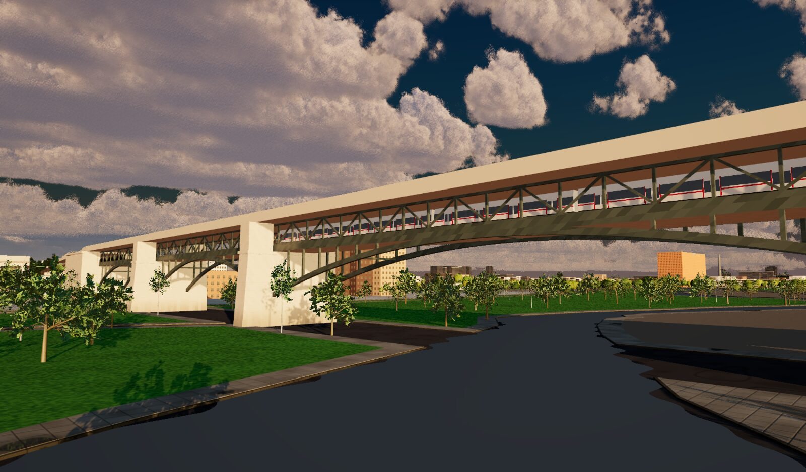
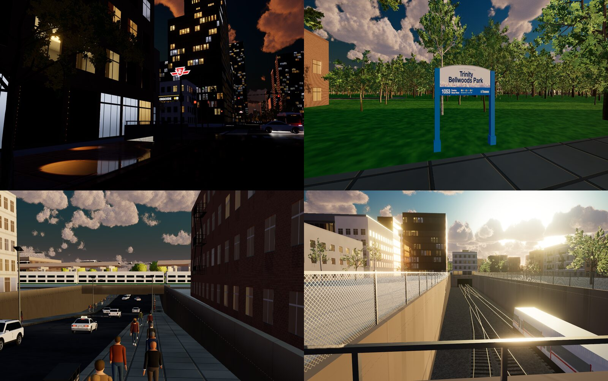

# Slop Toronto

Downtown Toronto and the waterfront in 3D, in the browser: walk, cycle, drive or fly from the Humber Bay Arch Bridge
along the lake to Sugar Beach, past the CN Tower and through downtown. Built with [three.js](https://threejs.org/)
WebGPURenderer and TSL on the engine of [Slop New York](https://github.com/mrdoob/slop-newyork) by mrdoob, by way of
its fork Abuja Tour. Needs a WebGPU browser (recent Chrome or Edge).

**Live: https://slop-toronto.cloud6711.workers.dev/explore.html**

## What's in it

- **The TTC subway:** Line 2 Toronto Rockets cross the Don Valley on the Bloor Viaduct's lower deck and run through
  the open cuts in the west end (Runnymede to High Park, Keele past Vincent Yard). 27 stations have their stairways on
  the street and the TTC insignia pylon at 86 entrances, each with the station's name, lines and accessibility.
- **Streetcars and GO trains:** TTC streetcars on the real streetcar network (no buses on streetcar routes), and GO
  trains on real bridges and embankments over the streets, from OpenStreetMap. Union Station has an open train shed
  over its platforms, and Strachan Avenue dips under the tracks in a cutting.
- **Toronto's cycling network:** the City's bike lanes, cycle tracks (Bloor, Richmond & Adelaide, Sherbourne,
  University...) behind their curbs & flexi-posts, green crossrides, sharrows, and the multi-use trails, the Martin
  Goodman Trail's red asphalt past Sugar Beach among them, from City of Toronto Open Data; the traffic keeps out of
  them, and both maps show them.
- **Street furniture from the City's data:** the City of Toronto's park name signs at 240 parks, each with its own
  name and address, plus hydrants, bike rings, transit shelters, litter bins and post boxes where the City says they stand.
- **Sky and sound:** volumetric clouds with golden hour, sunset and night, and a city that sounds like one: traffic,
  streetcars, the lake.

## Run it

No build step for development: `npm run dev` (or `python3 -m http.server 5530 --bind 127.0.0.1`) and open
`http://127.0.0.1:5530/` (landing page) or `/explore.html` (the city).

## Publish

The site is static. `node tools/build-site.mjs` copies what the pages load into `dist/`: the two pages, `css/`,
`assets/` and only the `js/` files the pages load (followed through their imports), plus `dist/_headers`. Cloudflare
serves `dist/` as a Worker's static assets (`wrangler.jsonc`):

- **Production** deploys from the `release` branch (Cloudflare Workers Builds: build `node tools/build-site.mjs`,
  deploy `npx wrangler deploy`).
- By hand: `node tools/build-site.mjs && npx wrangler@4 deploy`.

## License and data

The project code is open source under the [MIT License](LICENSE). Data, models and third-party code keep their own
licences: see [CREDITS.md](CREDITS.md). In short: City of Toronto Open Data (Open Government Licence – Toronto),
© [OpenStreetMap contributors](https://www.openstreetmap.org/copyright) (ODbL; the built city database
`js/toronto-geodata.js` is ODbL too), AWS Terrain Tiles (SRTM). The ROM model is not under the MIT License.

## Rebuild the city data

`node tools/build-geodata.mjs` rebuilds `js/toronto-geodata.js` from the raw downloads (`tools/fetch-*.mjs`: OSM via
the Geofabrik Ontario extract and GDAL, the City of Toronto Open Data sets, AWS terrain tiles), with `GEO_DATA`
pointing at the downloaded folder.
The subway (lines, stations, street entrances) is its own file: `node tools/build-subway.mjs` writes
`js/toronto-subway.js` (`tools/fetch-osm.mjs` with `ONLY=rails` and `ONLY=subway` fetch its inputs).
