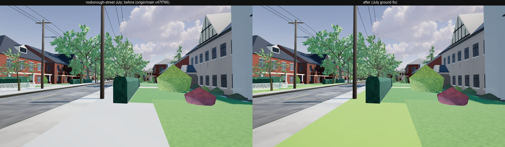
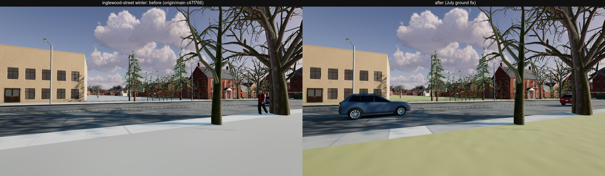
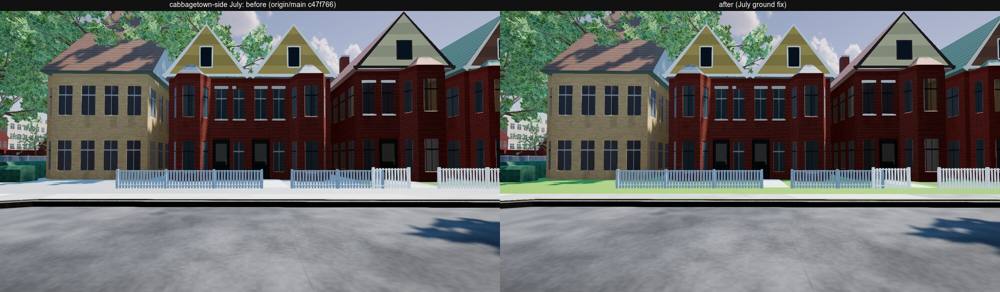
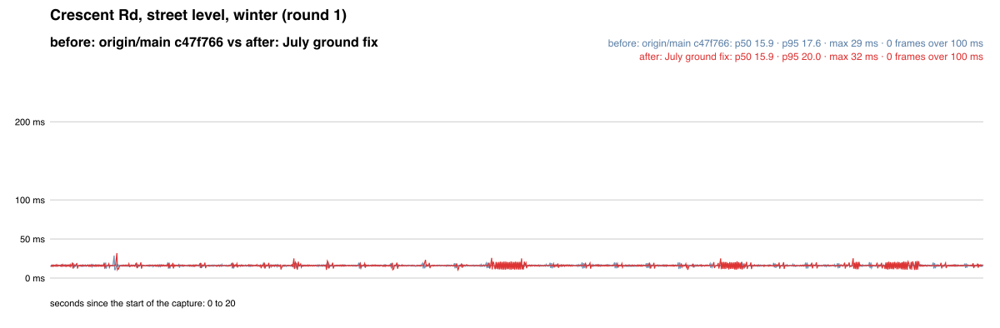

# Block paving: why the ground in house streets was pale concrete

Bead `jf-aru`, 2026-11-27. John, looking at the front-yards pictures: the July ground on Rosedale and other house streets "reads as white / concrete" (`crescent-street-july.jpg`); the page's snow value was 0.

## What was wrong

It was not snow. `uSnow` was 0 in every July frame (and there is no snow record for today, 2026-11-26, either). The ground in those blocks was the **Forecourts** mesh, the page's poured-concrete material for
"downtown" blocks (`createForecourtMaterial`, `js/tsl-materials.js`), which has no grass, no mulch and no snow in it. `js/city-grid.js` decides per block whether it is downtown (concrete to the building line)
or a plot (the lawn, mulch and paving of `createPlotGroundMaterial`), and the test was: inside the downtown box, or **any one building of 20 m or more**, or a 14 m building with a 1,500 m² average footprint.

Those heights are the City's `MAX_HEIGHT`, which includes tree canopy ([rosedale-heights.md](rosedale-heights.md): half of Rosedale's houses stand a median 8 m too tall in them, and `city-grid.js` runs before the lidar
heights are put on the buildings). A block of 46 houses with one house under a big tree was "a tower block". At build time Crescent Rd's block (41 houses) had a 30.2 m box, Roxborough Dr's block (36 houses) a 25.4 m
one, and **42 of South Rosedale's 46 blocks, 22 of North Rosedale's 22 and 20 of Moore Park's 23 were concrete**. The sidewalks in them took the "downtown" flag too (paler new-pour bands).

## The fix

`blockStandsDowntown` in `js/city-grid.js` (tests: `tests/block-paving.test.mjs`). A block outside the downtown box is downtown when

- 15% of its built footprint stands **28 m or more** (a tree adds up to about 20 m to a house in the City's heights, so under 28 m a box may be a house), or
- 6% of it stands **40 m or more** (a tower, whatever the trees), or
- it keeps the old test of big footprints at 14 m (a 1,500 m² average).

Everything else is a plot: the plot ground's lawn, mulch and paving, and snow on them in winter. Of the 5,964 blocks with buildings, **2,877 were paved before and 1,225 are now** (1,652 became plots, none
became paved). By neighbourhood, paved before -> now: South Rosedale 42 -> 12 of 46, North Rosedale 22 -> 0 of 22, Moore Park 20 -> 0 of 23, Cabbagetown 27 -> 0 of 53, the Annex 110 -> 46 of 174, South Riverdale 142 -> 34 of 268,
the Beaches 95 -> 11 of 145, Leaside 29 -> 3 of 67. The blocks that stay paved are the tower and slab blocks (Flemingdon Park 19 -> 13 of 28, Thorncliffe Park 24 -> 21 of 60).
The downtown box (x -1150 to 1500, z -2750 to 650) is untouched.

What it costs: a mid-rise block of 20 to 28 m outside the downtown box that the old test paved is now a lawn around its buildings.

## Pictures

Before = origin/main `c47f766`, after = this branch, the same cameras (`tools/capture-front-yards.sh JOB=ground`), winter (today's date, no snow on record: the "snow" was the concrete) and July.







## Cost

Mac mini (Apple M4) through `gpu2`, 1600 x 900, uncapped, 20 s recordings at Crescent Rd's street level, origin/main `c47f766` against this branch, alternated: mean / median frame interval, ms, before -> after.

| | Winter | July |
|---|---|---|
| Round 1 | 15.90 -> 15.96 (+0.05) / 15.90 -> 15.90 | 15.54 -> 15.59 (+0.05) / 15.50 -> 15.60 |
| Round 2 (after first) | 15.90 -> 15.95 (+0.05) / 15.90 -> 15.95 | 15.53 -> 15.60 (+0.07) / 15.50 -> 15.60 |

The mini was shared with a production transcription job; these are relative numbers, not budgets. Nothing new is drawn: blocks move from one existing mesh (Forecourts) to another (Yards).



## Reproduce

```sh
node --test tests/block-paving.test.mjs
JOB=ground ARMS="before after beforeJul afterJul" bash tools/capture-front-yards.sh   # on the Mac mini through gpu2
```
