# Front yards, fences and gardens

Bead `jf-ugq`, 2026-11-27. John: "something that we don't really have are front yards and fences. Like for a lot of, especially Rosedale, there are fences and front yards and gardens and things, and that's totally missing."
After [the Rosedale walls](rosedale-walls.md) the houses had a walk, a hedge or a low wall on about two houses in five (from a rule), and a flat grey drive: from the street the yards read as empty snow or
grass. This PR draws them as yards, on by default with the Rosedale pilot (the bigger map, desktop).

## 1. What is drawn

Per house, in `js/front-yards.js` (pure; `planHouse` calls `planYard`), written to one yard mesh a 500 m cell and shown with the cell's full roofs (within 250 m of the camera: nothing past that):

| Thing | Kinds | From |
|---|---|---|
| Hedges | clipped cedar and boxwood (evergreen), privet (deciduous), 0.6 to 4 m, a bevelled top | **the 2023 lidar**, where the lot has them (section 2); else the rule |
| Shrub masses | rounded domes, evergreen or deciduous | **the lidar** (up to 12 a lot), and 2 to 4 foundation shrubs along the front wall by rule |
| Lot line | stone wall with piers and a cap, brick wall, wrought iron (alpha-tested bars on a low stone plinth, posts, rails), picket, chain-link, nothing; a gap at the walk, the drive's mouth cut out, a short return along each open side | a rule by neighbourhood style (`YARD_STYLES`) and a stable per-house seed |
| Beds | mulch along the front wall (in the spans the porch, bays and door leave) and along each side of the walk; flower dots in spring and summer | rule |
| Lawn | between the walk and the drive, the season's grass colour; not drawn where snow lies | rule |
| Walk, drive, porch steps, an ornamental tree (a Japanese maple or crab apple), a lamp post | | rule |

The page's season drives all of it from the existing uniforms (`uLeaf`, `uAutumn`, `uSpring`, `uDormant`, `uSnow`; `js/front-yard-material.js`): evergreens keep their green and take a snow cap, deciduous shrubs go
through autumn colour and then bare twigs (a brown cut-out), lawns follow the dormant turf and vanish under snow (no green sheet on snow), beds show flowers only while leaves are on. A date change is uniform writes only.
One material draws every kind: vertex `uv` = (kind, random), `aux` = (metres along a run, height over its foot).

Variety: every choice comes from `stream(house id, ...)`, so a house is the same on every load and no two neighbours match. Style weights (the lot line's treatment) by neighbourhood, after the photographs John named:
Rosedale stone walls with piers, cedar hedges and wrought iron; the Annex and Cabbagetown wrought iron and low pickets; Leslieville and Riverdale pickets, chain-link and low brick; the Beaches pickets and hedges.

## 2. Hedges and shrubs from the lidar

The GTA 2023 point cloud has **no vegetation classes** (3, 4 and 5 are empty): trees, hedges, shrubs, fences and cars are all class 1, "unclassified". The shared data repo's `build/front-yards/` (dataset
`front-yard-vegetation/1`, record `front-yard-vegetation-lidar`) grids class 1 over a ground model made from the ground returns (0.5 m cells, five height bands) and finds, per house lot (the City parcel, grown 0.6 m):

- **hedges**: pieces at least 3 m long and at most 3.2 m wide, 0.6 to 4.2 m tall, with open sky over them (at most one return over 4 m in the cell), centreline by walking the piece's own cells;
- **shrub masses**: compact leafy pieces up to 5 m across.

Over 3,543 lots: 3,110 hedge runs (14.4 km on 1,834 lots) and 11,226 shrub masses (3,118 lots). 2,862 hedges and 10,931 shrubs are in the houses file (the 3,471 pilot houses); the page draws those in the front yard and
side yards (a run only the back garden has is skipped). Under a tree crown nothing can be seen: 1,689 lots have a crown over more than half of their open ground, and the lot's `canopy` share goes in the file so a
lot with no lidar hedge and a lot of canopy keeps the full rule, an open yard with none is mostly an open yard.

**Fences and low walls are not found.** The share of lot-boundary samples with a return 0.6 to 2.5 m up is 14.5% on the parcel line and 10.5% on a line 3 m inside it (600 lots): at 33 returns a m2 a board fence,
an iron fence or a wall leaves 0 to 2 returns a cell, too close to noise. Fences and walls stay a rule.

Honest limits: the hedges were checked by eye against the City's 2025 photo in six 120 m windows, not against an inventory: front hedges are found, a fair share of obvious ones under tree edges are missed, and a few
tall cedar rows and low trees come out as shrub masses. The flight is leaf-on (2023-05-11), so heights are summer heights.

## 3. Cost

Same camera, Mac mini (Apple M4) through `gpu2`, 2026-11-27, 1600 x 900, uncapped, 20 s recordings (`tools/frame-time-chart.mjs --overlay`), the winter page (today's date, bare trees), **origin/main `1e768b7`** against this
branch, paired and alternated in short jobs (`tools/capture-front-yards.sh JOB=frames`). The mini was shared with other agents (a production transcription ran during every job), so these are relative figures, not budgets. Mean / median frame interval, ms,
before -> after (difference in the mean), three rounds of the final build (round 6 and 8 ran "after" first, round 7 "before" first):

| Place | Round 6 | Round 7 | Round 8 |
|---|---|---|---|
| Crescent Rd, street level | 15.66 -> 16.44 (+0.79) / 15.60 -> 16.50 | 15.66 -> 16.42 (+0.76) / 15.70 -> 16.40 | 16.66 -> 16.47 (-0.19) / 16.60 -> 16.50 |
| South Rosedale, 160 m up | 14.60 -> 15.28 (+0.67) | 14.61 -> 15.27 (+0.67) | 15.55 -> 15.29 (-0.26) |
| Whole neighbourhood, 520 m up (no yard is drawn) | 13.43 -> 13.94 (+0.51) | 13.42 -> 13.94 (+0.52) | 14.15 -> 13.96 (-0.19) |

The budget was no worse than +1 ms at street level: met in all three rounds (+0.8, +0.8, -0.2). The 520 m view draws no yard at all (a yard mesh exists only within 250 m of the camera) and moves by the same
amount in each round, so most of what shows at the street is the mini's run-to-run drift between arms, not the yards; the yards' own share at street level is at most a few tenths of a millisecond. An earlier build that drew a whole 500 m
roof cell of yards at once measured +0.7 to +1.2 at the street, which is why the yards are now written into 125 m sub-cell meshes and drawn within 250 m.

How it is kept cheap: a yard is about 135 triangles (2,490 yards, 340 k triangles in all for the pilot, 20 KB a house), written into a mesh **when the camera comes within 250 m of its 125 m sub-cell** and dropped beyond 330 m, one sub-cell a frame
(about 150 houses, a few ms), so nothing is resident far away and the load does not plan any (`CITY.frontYardStats` counts what has been built). The material is compiled at load with a degenerate triangle. Hedges and shrubs cost nothing at 160 m and above. The houses file
is 0.56 MB gzip (0.49 before: the hedges, shrubs and canopy shares). `?frontYards=0` turns the yards off.

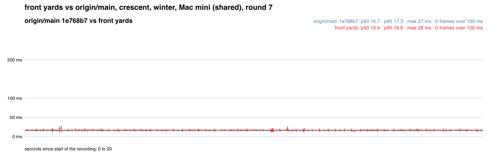

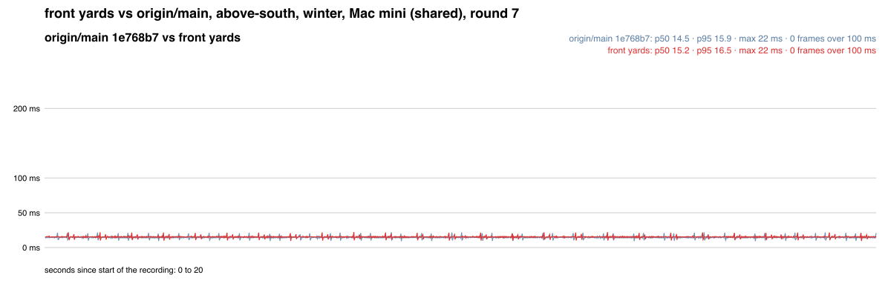

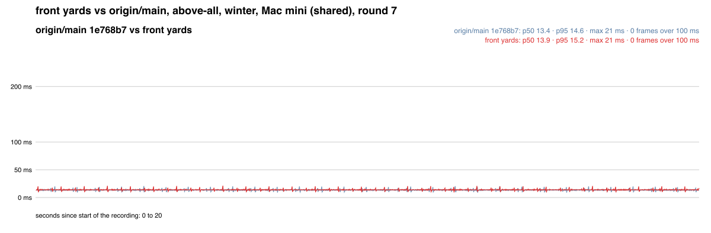


## 4. Pictures

Six houses (115 Park Rd, 83, 93 and 112 Roxborough Dr) each from the far sidewalk and from a bike on the road (1.45 m up, 24 m along), and four streets (Crescent Rd, Highland Ave, Roxborough Dr, Inglewood Dr), before (origin/main) and after, in winter (today:
bare trees, 2026-11-26) and July (2026-07-15, leaves, no snow record), are in John's review folder `slop-toronto-updates/2026-11-27-front-yards/rosedale/` (a side-by-side per view, raw frames in `raw/`). Three of them:

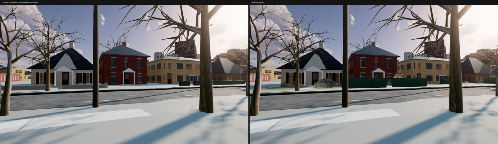

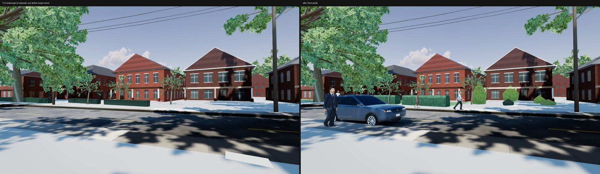

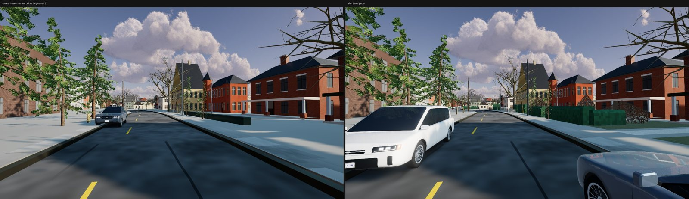

What reads wrong: the page's own ground in these blocks is a pale concrete colour (not snow: `uSnow` reads 0 in the July frames), so in July the lawn is a green patch on a pale plot; hedges are clean boxes with flat shading; bare shrubs are a speckled cut-out;
the shot cameras are the walls shot list's, and two of the old list's houses (338 Douglas Dr, 4 Beaumont Rd) look onto park grass, so they are replaced by the four street views.

## 5. Every other drawn house (citywide)

The same planner now draws a yard for every detached, semi and row house the preset machinery draws (`isHousePreset`: the downtown frame, 17,210 front yards in all with the Rosedale pilot's 2,490), in the style of its neighbourhood: `yardStyleOfPlace` maps
the City neighbourhood `districtAt` names (Rosedale, Annex, Cabbagetown, Leslieville and Riverdale, the Beaches, post-war Leaside and the like) to a `YARD_STYLES` entry, cached per 100 m. No lot width or lidar is known there, so the side yards are a metre
each and hedges and shrubs are the rule's; a house whose road leaves under 2.2 m of yard has none (most downtown rows). `?frontYards=0` turns them all off. Pictures (before = origin/main) of four streets from the sidewalk and from a bike, in winter and July, in
`slop-toronto-updates/2026-11-27-front-yards/other-neighbourhoods/` (cameras at the page's own yard sites, `CITY.frontYardSites`, fixed per arm):

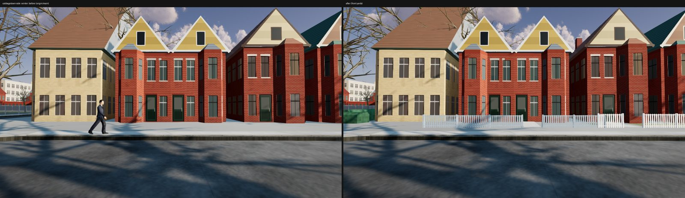

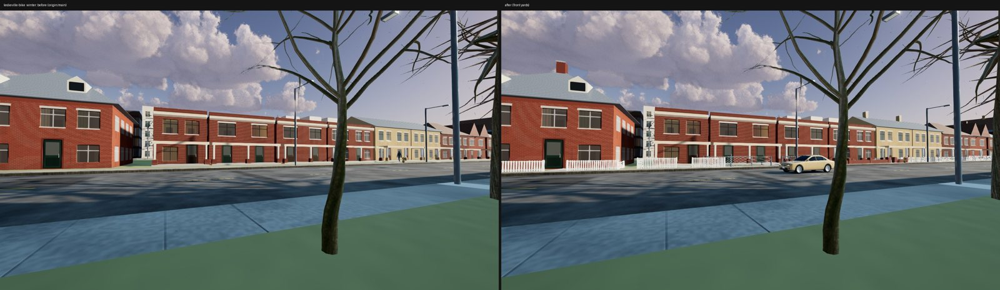

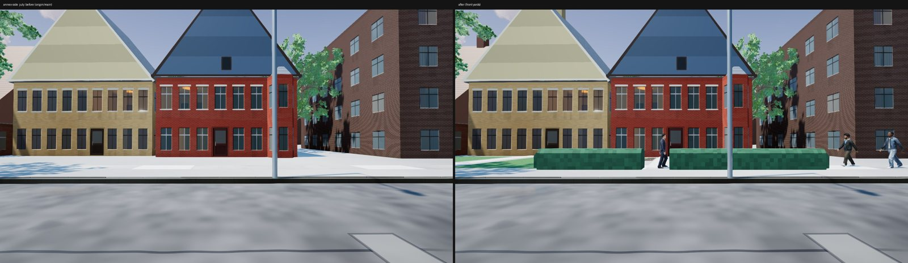

**The Beaches get none**: the house presets are drawn only inside the downtown detail frame (x up to 3,700 m) and the Beaches lie outside it, so no house there is a drawn house and has no yard to give. The same holds for every house on the bigger map outside the frame and outside the Rosedale pilot.

Cost (Mac mini, shared, winter, paired against origin/main, two rounds, alternating, street level in three drawn neighbourhoods; mean ms before -> after): Cabbagetown 18.64 -> 19.01 (+0.38) and 18.56 -> 18.73 (+0.17); Leslieville 14.66 -> 14.71 (+0.05) and 14.33 -> 13.91 (-0.42);
the Annex 18.71 -> 19.43 (+0.72) and 18.59 -> 18.75 (+0.16). Within the +1 ms budget in every pair (`tools/capture-front-yards.sh JOB=framesO`).

## 6. Polish (jf-aru, 2026-11-27)

John looked at the shipped pictures and chose "polish, and fix the July ground". The pale ground was a separate bug, [block paving](block-paving.md) (shipped first). The rest:

| Was | Now |
|---|---|
| Hedges: flat dark boxes with a pixelated texture | A rounded loaf (vertical sides, a rounded shoulder, a flat crown) in sections about 1.1 m long with a little wobble of the surface and the crown's height; smooth normals; the material gives it leaf-sized speckle (smooth 3D noise at 11 cm and 4 cm, fading to a plain tone where a leaf is under a pixel, so it does not shimmer), lighter new growth in spring and summer, and breaks the silhouette into leaf-sized bites where the surface turns away from the eye; a fringe of leaf cards (kind 8, 9 for a deciduous hedge) leans out of the shoulders every 0.4 m; a snow cap in winter; a privet hedge is bare twigs in winter |
| Bare shrubs: a speckled brown cut-out heap | A deciduous shrub is a rounded shell (four rings, nine sides, low) that is leafy in summer and, when the leaves drop, a lattice of thin twigs: three families of warped lines in 3D with dropouts and clumps, so most of the shell is sky, over 3 to 5 thin stems with a fork; a line is never thinner than about a pixel. Evergreen shrubs (yew, boxwood, juniper) keep their green, rounded, with leaf cards and snow on top |
| Ornamental tree: a green cone | `smallTree`: a Japanese maple (deep red), a crab apple, a magnolia (evergreen) or a dwarf conifer. A trunk and five branches with forks (thin stems, the winter tree), 44 leaf cards of leaf discs in the crown (bare in winter, in autumn colour on the way), a conifer's six whorls of needle fans. It is built in the yard mesh, not from `js/ez-trees.js`: the page's tree kit has only ash, aspen, oak and pine models and another agent owns that file |
| Lawn: a bright flat green sheet with hard edges | The lawn is the plot ground's own grass (the same colour function, `createPlotGroundMaterial`, with `fbm2` and `noise2D` now on `window.CITY`), a ragged soft edge from noise, gone under snow. Mulch beds have the same ragged edge, bark-chip grain and a tone per bed |

The twigs, cards and needle fans are kinds 8 to 11 of the one yard material (`js/front-yard-material.js`); the lawn and bed rectangles carry their half sizes in `color` and the metres from their centre in `aux`. A yard is 434 triangles on average (135 before), at most 1,768.

Pictures, same cameras as before, before = origin/main `c47f766`, winter (today: bare trees, no snow on record), July and (after only) 8 cm of snow, in John's review folder `slop-toronto-updates/2026-11-27-front-yards-polish/`:

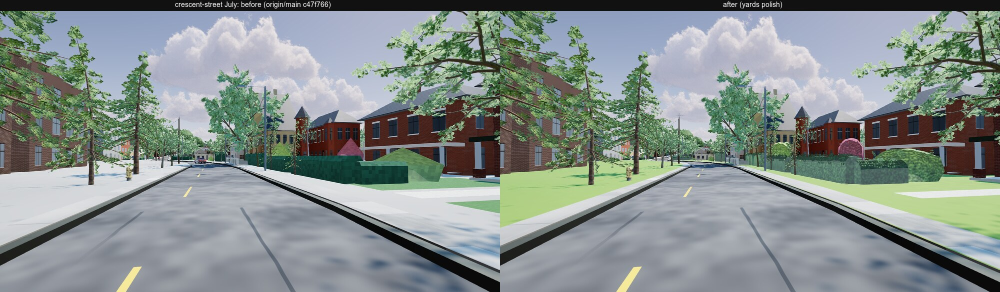

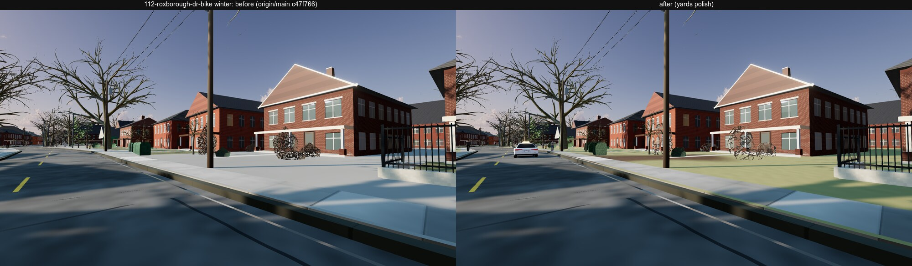

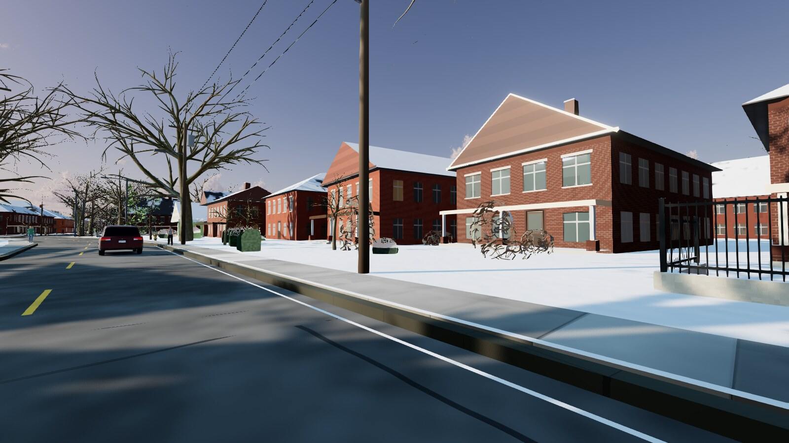

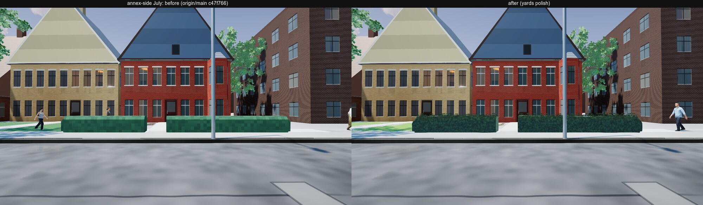

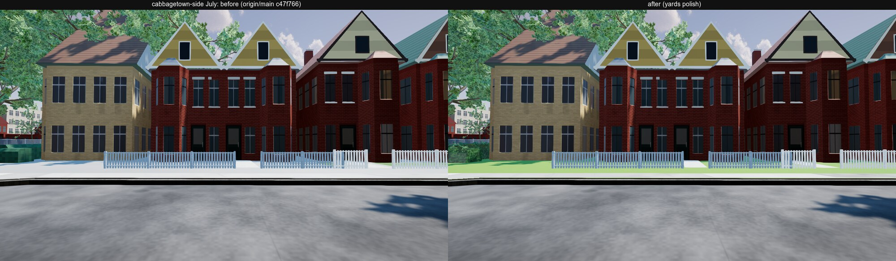

Against photographs: Wikimedia Commons has a CC photo of Cabbagetown and of the Annex front gardens (side by side in the review folder, `photo-comparison/`); none of a Rosedale house frontage on the four streets, and Street View's terms do not allow keeping its images. The photographs show what is still missing: porches and steps with planting, tall perennials and flowers, dense layered beds.

**Cost** (Mac mini, Apple M4, shared with a production transcription job, 1600 x 900, uncapped, 20 s recordings, origin/main `29066ca` against this branch, alternated, mean / median ms, before -> after; budget +0.5 ms at street level):

| Place | Round 1 | Round 2 (after first) |
|---|---|---|
| Crescent Rd, winter | 15.98 -> 16.25 (+0.26) / 16.00 -> 16.30 | 15.97 -> 16.24 (+0.27) / 16.00 -> 16.30 |
| Crescent Rd, July | 15.62 -> 15.83 (+0.21) / 15.60 -> 15.80 | 15.63 -> 15.88 (+0.25) / 15.60 -> 15.90 |
| Annex, winter | 18.02 -> 18.18 (+0.16) / 18.00 -> 18.20 | 18.03 -> 18.17 (+0.14) / 18.00 -> 18.20 |
| Cabbagetown, winter | 18.11 -> 18.18 (+0.08) / 18.10 -> 18.10 | 18.15 -> 18.00 (-0.15) / 18.10 -> 18.00 |
| Leslieville, winter | 13.49 -> 13.42 (-0.08) / 13.50 -> 13.30 | 13.36 -> 13.39 (+0.03) / 13.30 -> 13.40 |

Within +0.3 ms everywhere.

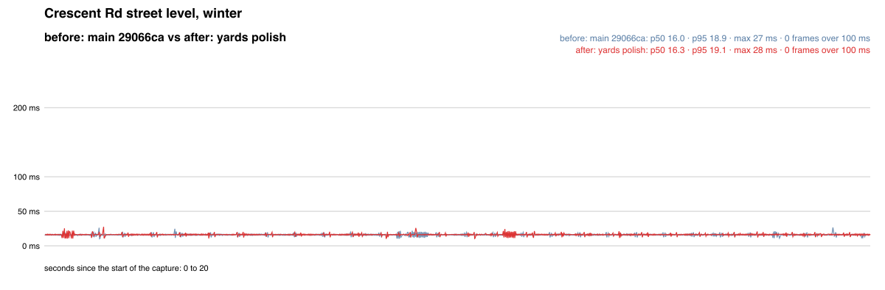

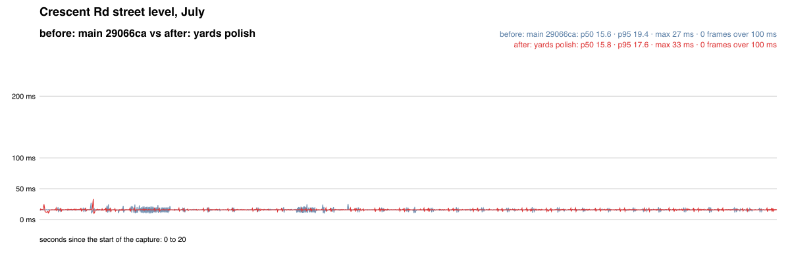

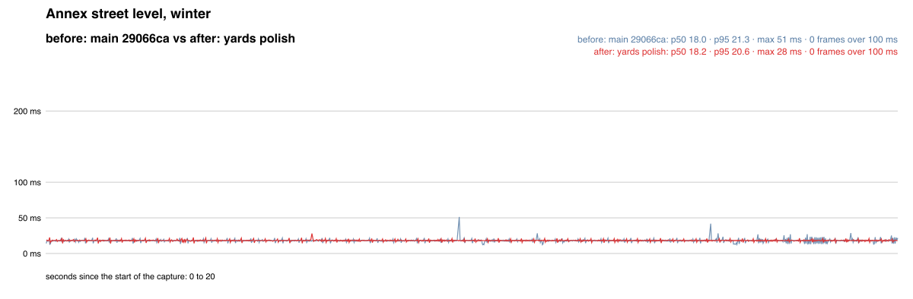

## What is still wrong

- Fences and walls are a rule, not data; hedges the lidar could not see (under crowns) are the rule's too.
- No yard is drawn for a house the preset machinery does not draw (the Beaches, anything outside the downtown frame and the pilot), or whose yard is under 2.2 m deep.
- The yard stands at the house's ground height: a lot that falls steeply to the street shows the hedge and wall skirts (0.4 m) rather than following the slope.
- Bare shrubs are a twig lattice on a shell plus a few stems, not a grown branch structure; beds are mulch with plant dots, not layered planting with perennials, porches and steps.
- Highland Ave's shot camera in the shared shot list stands inside a house (it was before this work too).

## Notes

- Frame times were not measured on a phone or the low tier: the yards (and the Rosedale pilot) are desktop-only.
- The cameras' sites come from `CITY.frontYardSites` (the page lists where it drew yards).

## Reproduce

```sh
# the shared data repo (its venv, see build/rosedale-houses/README.md): the grids, then the hedges
~/.cache/toronto-data/venv-houses/bin/python ~/code/toronto-data/build/front-yards/extract_grids.py
~/.cache/toronto-data/venv-houses/bin/python ~/code/toronto-data/build/front-yards/find_hedges.py ~/.cache/toronto-data/derived/front-yards/1/hedges.json
# the houses file (reads derived/front-yards/1/hedges.json next to the roofs; FRONT_YARDS_JSON overrides)
node tools/build-rosedale-houses.mjs "$TORONTO_DATA_CACHE/derived/rosedale-roofs/1/roofs.json" "$TORONTO_DATA_CACHE/derived/rosedale-houses/1/houses.csv"
node --test tests/front-yards.test.mjs
JOB=rosedale ARMS="before after beforeJul afterJul" bash tools/capture-front-yards.sh   # on the Mac mini through gpu2, see the script's header
```
