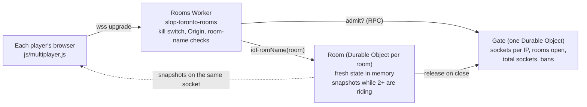

# Slop Toronto Multiplayer Spec

2026-10-28 · John Fewell · revision 2 (after the review of revision 1; see [Review resolutions](#review-resolutions))

## Summary

With multiplayer, you can see other real people riding, walking, driving and flying through Slop Toronto at the same moment, and ride with friends from a shared link. Other players are ghosts: no collisions, no shared physics, no shared traffic. Each room is a Durable Object in a separate rooms Worker. That Worker has a staging copy for testing, an admission gate that bounds the bill, and a kill switch. The site's own Worker doesn't change.

What revision 2 changes from revision 1:

- **Privacy:** a player whose position is private sends no position at all. That also holds after a reload, and share links carry no position then.
- **Separate rooms Worker:** the rooms move out of the site's Worker, so site previews keep working and staging has its own Durable Object namespace.
- **Spending:** a gate bounds sockets and rooms across the whole service, so the worst-case bill is a number.
- **Presence:** rooms only rebroadcast fresh samples, and inactive sockets are released.
- **Draw budget:** one total model cap covers every mode, helicopters included.
- **Measurement:** main-thread time, frame-time tails and GPU time are measured separately.

Goals:

- **The city feels alive with people, not just NPCs:** you see other riders on the waterfront and can tell they are real.
- **Riding with a friend is one link.**
- **Privacy:** a player's real location is never published by the game.
- **Bounded cost:** spending has an enforced ceiling, and one switch turns multiplayer off.
- **Frame budget:** no measurable change in frame-time tails on the M4 mini tier.

## Scope

Version 1 is presence. You see the other players move and you can share a room. You can't touch them, talk to them or race them.

| In v1 | Not in v1 (and why) |
| --- | --- |
| Other players drawn in all four modes, within one total model budget | Collisions, crashes or ragdolls between players: these need shared physics, and the server would have to decide what happened |
| A public room you join on load, up to 50 players | Text or voice chat: moderation, and it doesn't fit the mood |
| Private rooms from a link (`#room=…&at=…`) | Accounts, sign-in or saved friends |
| A generated name and a colour per player | Names players type |
| "N riding" in the HUD | Races, leaderboards, segments |
| Off with `?mp=0`, through the server's kill switch, and whenever the rooms can't be reached | Passengers sharing a streetcar or subway car |

Traffic, pedestrians, streetcars and weather are not kept in sync: two players at the same corner may see different cars.

## Privacy

The game never sends a position that is within the private zone around the player's real location, including after a reload, and it never puts one in a share link. What an observer can still learn is stated below: it is a neighbourhood, not nothing.

**The private zone:**

- When the locate card (`js/tour-guide.js`) gets a GPS fix inside the city, the client records a private zone: a 500 m circle round the fix.
- The zone is stored in the same `localStorage` entry as the saved player state (`toronto-player-state` in `js/main.js`). It is local to the device, like the saved position already is, and is never sent anywhere.
- The zone is cleared once the player has published from outside it (see "Resuming" below), or when they press "Forget my location" on the locate card.

**While private, the client sends no position:**

- It sends a `hide` frame, which has no coordinates in it (see Protocol). This covers every hidden case: in the zone, a passenger on a streetcar or the subway, a tab in the background.
- The `hide` decision is made before anything is serialized, from the position the frame would otherwise carry. An implementation cannot send coordinates and mark them hidden, because the frame has no position fields.
- When the room gets `hide`, it deletes that player's stored state and tells everyone `hidden` with the player's id. Clients remove that ghost at once and drop its sample buffer.

**After a reload:**

- If the restored position is inside a stored private zone, the first message after `welcome` is `hide`. That holds whether or not a GPS fix exists in this session.
- `#at=` in a link the player opens doesn't change this: arriving inside your own zone keeps you hidden.

**Share links:** "Ride with a friend" includes `at=` only while the player is publishing. While hidden, the link carries the room alone, and the friend starts at the default start.

**Resuming:** publishing starts again only in one of two ways:

1. A teleport (map, Sights, `#at`) lands outside the zone.
2. The player has moved more than 2 km from the zone's centre.

**What can still leak:** when someone reappears by riding out, an observer can infer that they were within about 2 km of where they reappeared. That is neighbourhood-level information, and the help text says so plainly: "Your real location is never shared. Other players see you again once you're 2 km away or teleport."

## Architecture

The site Worker doesn't change. The client connects straight to a separate rooms Worker, which holds two Durable Object classes: `Room` (one per room) and `Gate` (one instance, admission and limits).

**Why a separate Worker:** Cloudflare doesn't generate Version URLs for a Worker that implements a Durable Object ([Previews](https://developers.cloudflare.com/workers/configuration/previews/)). Putting `Room` in `slop-toronto` would end the `versions upload --preview-alias` previews the site uses today. A separate Worker keeps them, and gives staging its own Durable Object namespace.

**Deployments:**

| | Production | Staging |
| --- | --- | --- |
| Worker | `slop-toronto-rooms` | `slop-toronto-rooms-staging` (a wrangler environment, `--env staging`) |
| URL | `wss://slop-toronto-rooms.cloud6711.workers.dev` | `wss://slop-toronto-rooms-staging.cloud6711.workers.dev` |
| Durable Object namespaces | its own | its own (environments are separate Workers) |
| Pages that connect | `sloptoronto.ca`, `www.sloptoronto.ca`, `slop-toronto.cloud6711.workers.dev` | every preview alias of the site, and `localhost` |
| `ROOM_CAP` / `PER_IP` | 50 / 8 | 60 / 60 (so a 50-bot run fits next to two people) |

- **Choosing a Worker:** the client picks by its own page host: the production site uses production rooms, and anything else uses staging. `?mp=wss://…` overrides this for local testing.
- **Migration path:** the first deploy of each Worker carries migration `v1` (`new_sqlite_classes: ["Room", "Gate"]`) and goes out with `wrangler deploy`, staging first. Gradual deployments aren't used for this Worker.
- **Rollback:** set the kill switch, not a `deleted_classes` migration, so the classes and their names stay valid.

**Rooms Worker (`rooms/worker.js`):**

- **Kill switch:** with `MP_ENABLED` set to anything but `"on"`, every request gets a 503 before any Durable Object is touched, and clients ride alone. Flipping it is a `wrangler deploy --var MP_ENABLED:off` (seconds).
- **Room names are checked before any object lookup:** `public-1` … `public-<MAX_PUBLIC_ROOMS>` (default 2), or exactly 6 lowercase letters. Anything else, `public-99999` included, gets a 404.
- **Origin check:** `Origin` must be on the deployment's list (see the table). This only stops other sites embedding the rooms; it doesn't authenticate non-browser clients. The Gate's limits do that work.
- **Hand-off:** after `Gate.admit(ip, room)` says yes, the request goes to `ROOMS.get(idFromName(room))`. Public rooms get `locationHint: "enam"`.

**Gate (`Gate`, one instance named `gate`):**

- **What it tracks:** open sockets per IP, private rooms opened per IP, total sockets, total rooms, and temporary bans. Stored in its SQLite storage, so eviction doesn't reset the limits.
- **Leases:** rooms hold a lease per socket and renew them every 60 s from their alarm. Leases not renewed for 3 minutes expire, so a crashed room can't hold slots for ever.

| Limit | Default | Why |
| --- | --- | --- |
| Sockets per IP, across all rooms | 8 | A household or a café on one Wi-Fi, a few tabs, a carrier's shared address |
| New connections per IP | 10 a minute | Reconnect loops and scripted floods |
| Private rooms opened per IP | 1 | Stops one client taking the private rooms |
| Total sockets | 100 (`MAX_SOCKETS`) | Bounds message charges (see Cost: the ceiling is about $50 a month) |
| Total rooms | 6 (`MAX_ROOMS`): 2 public (`MAX_PUBLIC_ROOMS`), 4 private | Bounds duration charges |

With every slot taken, newcomers ride alone and the HUD says "Rooms are full, riding solo".
| Ban after a flood or malformed-frame close | 10 minutes, per IP | Abusive traffic is billed even when dropped, so it is cut off at the door |

**Room (`Room`, one per room name):**

- **On connect:** it accepts with the Hibernation API, assigns an id, name and colour (`serializeAttachment`), and sends `welcome`.
- **State:** it keeps each player's latest fresh state in memory, with the time it arrived.
- **The tick:** it runs only while at least two players have published within the last 2.5 s, since one player alone needs no snapshots. Otherwise there's no timer, and the object can hibernate between messages ([lifecycle](https://developers.cloudflare.com/durable-objects/concepts/durable-object-lifecycle/): no pending `setTimeout`/`setInterval`). A `state` message that brings the live count to two starts the tick again.
- **Expiry:** an alarm every 30 s, which doesn't block hibernation, closes sockets silent for 30 s (code 4002), releases their Gate leases and renews the rest.
- **After hibernation:** the player list is rebuilt from attachments. Positions refill as each client next sends: within 100 ms for a moving player, 500 ms for one standing still.
- **Deploys and network loss:** these drop every socket. Clients reconnect with exponential backoff (1, 2, 4 … 30 s) plus a random 0–2 s first delay, so a deploy doesn't cause a reconnect stampede.

## Presence

A ghost exists only while its player keeps sending. The room never makes an old sample look new.

| Situation | What the room does | What the others see |
| --- | --- | --- |
| Moving | `state` at 10 Hz | Smooth, 150 ms behind |
| Standing still | `state` at 2 Hz | Still, in place |
| `hide` (zone, passenger, background tab) | Deletes their state, broadcasts `hidden` | Gone within one tick |
| No message for 2.5 s (network loss) | Leaves them out of snapshots | Fades out at 2.5 s, from the sample's own age |
| No message for 30 s | Closes the socket, releases the slot, broadcasts `leave` | Already gone |
| Tab closed | Clean close, broadcasts `leave` | Gone at once |

- **Sample ages:** every snapshot record carries its sample's age, so a client knows how old the position is however often it is repeated. A repeated map record never refreshes liveness.
- **Counts:** "N riding" counts players who are publishing now (visible and fresh), you included. Hidden or silent players count toward the room's capacity but not toward "riding".

## Protocol

Positions travel as binary frames, and joins, leaves and names as JSON text. The binary layouts below are fixed for protocol version 1.

**Binary frames (little-endian):**

| Frame | Direction | Layout | Size |
| --- | --- | --- | --- |
| `state` | client → room | `u8 type=1` · `u8 mode` · `u8 flags` · `u8 epoch` · `f32 x` · `f32 y` · `f32 z` · `u16 heading` · `i16 speed` | 20 B |
| `hide` | client → room | `u8 type=3` · `u8 reason` (0 private zone, 1 passenger, 2 background) · `u16 reserved` | 4 B, no position |
| `snapshot` | room → client | `u8 type=2` · `u8 count` · `u16 riding` · `u32 roomTime` (ms) · then `count` records | 8 B + 22 B each, at most 49 records (1,086 B) |
| snapshot record | — | `u16 id` · `u8 mode` · `u8 flags` · `u8 epoch` · `u8 age` (10 ms units) · `f32 x` · `f32 y` · `f32 z` · `u16 heading` · `i16 speed` | 22 B |

**Fields:**

- **`mode`:** 0 person, 1 car, 2 cyclist, 3 helicopter. There's no hidden mode value; hiding is the `hide` frame.
- **`flags`:**
  - bit 0 is boost, sent by the client (car exhaust, cyclist out of the saddle).
  - bit 1 is map-only, set by the room: that record is for map dots and is never drawn as a model.
- **`epoch`:** a teleport counter (mod 256) that the client increments on every teleport and mode switch. A change between two samples means "snap, don't interpolate", however short the jump.
- **`age`:** 0–250, the time since the room received the sample. Records older than 2.5 s are never sent.
- **`roomTime`:** milliseconds since this room object started. A client resets its clock estimate on every `welcome`, and whenever `roomTime` goes backwards by more than 1 s (a restarted object). The u32 wraps after 49 days, which no object lives to.
- **Ordering:** WebSockets are ordered, so frames need no sequence number. A reconnect starts afresh with `welcome`.

**Control frames (JSON text):**

| Message | Direction | Fields |
| --- | --- | --- |
| `welcome` | room → client | `id`, `name`, `colour`, `room`, `players: [{id, name, colour}]`, `riding` |
| `join` / `leave` / `hidden` | room → all | `id` (plus `name`, `colour` on `join`) |
| `riding` | room → all, when it changes | `n`: players publishing now. It keeps the HUD right when there are no snapshots (fewer than two riding). |
| `full` | room → client, then close (4001) | `next`: the next public room, or `null` |
| `limited` | room → client, then close (4005) | `why`: `ip`, `rate` or `private` |

**Close codes:**

| Code | Meaning | Client response |
| --- | --- | --- |
| 4000 | Unknown protocol version | Ride alone; don't retry |
| 4001 | Room full | Try `next`; with no `next`, ride alone |
| 4002 | Idle | Reconnect when active again |
| 4003 | Malformed traffic | Banned for 10 minutes; ride alone |
| 4005 | A Gate limit for this network (sockets, connections a minute, private rooms) | Ride alone; retry after 60 s |
| 4008 | Flooding | Banned for 10 minutes; ride alone |

The version goes in the URL, as `/mp/<room>?v=1`.

**Snapshots:**

- **Contents:** every 100 ms while the tick runs, each client gets up to 24 players within 500 m, nearest first, each with a fresh sample.
- **Map records:** once a second, the snapshot also carries every other fresh player as a map-only record, up to 49 records in all.
- **Drawing:** clients draw only records without the map flag. Remote players are drawn 150 ms behind room time, between the two samples either side. If samples stop, a player carries on along their heading for up to 250 ms and then holds still, until they fade at 2.5 s.

**Validation, in the room, for every frame:**

| Check | Rule |
| --- | --- |
| Size and type | `state` exactly 20 B, `hide` 4 B, nothing else binary. Text frames from clients are ignored. |
| Numbers | `x`, `y`, `z` must be finite. `mode` must be 0–3. |
| World bounds | `x` from −13,900 to 9,700 m and `z` from −9,000 to 9,600 m: the detailed city (`GEO.frame.detail`) plus the helicopter's 6 km margin. `y` from −30 to 400 m. |
| Movement | Each player has a distance budget: (mode top speed × 1.5) × (time since their last accepted sample + 1 s). A sample beyond it is dropped, not punished, so bursts after network delay still pass. A sample with a new `epoch` skips the budget, at most once per 2 s. |
| Rate | 12 frames a second with a burst of 24, counting malformed frames. 20 malformed frames, or 3 s over the rate, closes the socket (4003 or 4008) and bans the IP at the Gate. |

## Client integration

One new script, `js/multiplayer.js`, plus `js/mp-protocol.js` shared with the rooms Worker. Existing files get small hooks.

| File | Change |
| --- | --- |
| `js/mp-protocol.js` (new) | Encode and decode for every frame above; room-name rules |
| `js/multiplayer.js` (new) | Connection, rooms, presence, interpolation, drawing, privacy decisions, the HUD button |
| `explore.html` | The two scripts before `main.js`; the HUD button in the toolbar |
| `js/main.js` | Create multiplayer before the warm-up frame (its models compile behind the loading screen); start it once the city is on screen; update it each frame; store and restore the private zone with the player state; apply `#at` |
| `js/tour-guide.js` | Record the private zone on a fix; "Forget my location" |
| `js/quality.js` | The remote model budget per tier (below) |

**Drawing within one budget:**

- **The cap:** each tier has one cap on full models, shared by every mode. Players beyond it get proxies, and players beyond 500 m aren't drawn.
- **Instanced:** cars and bikes are instanced, so their draw calls don't grow with the number of players. Cars use the traffic's instanced sedan material, which carries a per-instance paint colour.
- **Crowd:** walkers and riders share one skinned crowd (`PersonCrowd`), which has its own far level of detail.
- **Helicopters** are the costly case: one copy is about six meshes. They take full-model slots, and beyond their cap they are an instanced proxy.

| Tier | Full models (all modes) | Of which helicopters | Proxies | Remote shadows |
| --- | --- | --- | --- | --- |
| high | 12 | 2 | up to 24 drawn in all | full models only |
| medium | 6 | 1 | up to 12 in all | none |
| low | 0 | 0 | up to 6 in all | none |

**Not shared:** ghosts are left out of `world-collision.js`, `traffic.js` and `pedestrians.js`, so NPCs don't react to them and you ride through them.

## Riding with a friend

The inviter moves into the private room before any link exists, so the friend never arrives to an empty room.

1. **Creating the room:** from a public room, "Ride with a friend" makes a 6-letter room, leaves the public room and joins the new one. The HUD says "Starting your room…".
2. **Copying the link:** only after `welcome` from the new room does it copy `…/explore.html#room=abcdef&at=x,z`, leaving out `at=` while hidden, and say "Link copied". If the room can't be joined, it says so, and the player rejoins the public room.
3. **Repeated clicks:** in a private room, the button copies the same room's link again. A "Leave room" item returns the player to `public-1`.
4. **Opening a link:**
   - `#room` and `#at` take precedence over the saved position and the default start. `#place` and `#ride` deep links take precedence over `#at`.
   - If the private room is full or can't be reached, the player is told ("Your friend's room is full" or "Couldn't reach your friend's room, retrying"). They ride alone while it retries, and are never moved to a public room without being told.
5. **Reloading:** `#room` stays in the address while you're in a private room, so a reload returns there.

## Performance budget and measurement

Multiplayer must not move frame-time tails on the M4 mini tier. The phone claim waits until it can be measured on the Pixel 8.

What is measured, each with multiplayer on and off (`?mp=0`) in the same page, ABBA order:

| Measure | How |
| --- | --- |
| Main-thread time per frame | `?cputime=1` (`js/main.js`) extended with a multiplayer slice: socket handlers, decoding, interpolation, rigs, instance writes |
| Long tasks and handler cost | A `PerformanceObserver` for `longtask`, plus `performance.measure` around every message handler |
| Frame-time tails | p50, p95, p99 of frame intervals over 60 s |
| GPU time | `?gputime=1`, per pass, read separately |

Each measure is taken in five scenarios, on staging, with 48 bots and two people:

1. Bots spread over 2 km.
2. All 48 within 50 m of the camera.
3. All helicopters.
4. Join and leave churn (5 a second).
5. The low tier.

- **Pass:** p95 and p99 frame time within 1 ms of `?mp=0` on the M4 mini, with no new long tasks over 50 ms during joins or mode changes.
- **Phones:** no phone claim is made until the same runs pass on the Pixel 8 on the device.

## Cost

The expected cost depends on how many people share each room. The enforced ceiling doesn't: it is set by the Gate's caps.

**Pricing ([Cloudflare, read 2026-10-28](https://developers.cloudflare.com/durable-objects/platform/pricing/)):**

- **Paid plan:** 1 M requests and 400,000 GB-s a month included. Beyond that, $0.15 per million requests and $12.50 per million GB-s.
- **Messages:** incoming WebSocket messages count at 20:1, and outgoing messages are free.
- **Duration:** billed while the object is active and not eligible to hibernate, at 128 MB.
- **Rounding:** "billable usage is rounded up to the next billable unit" (1 million).

**How usage is counted:**

- **Requests:** one player-hour at 10 Hz is 36,000 messages, billed as 1,800 requests.
- **Duration:** a room is awake about 450 GB-s per hour while its tick runs, which is while two or more players are publishing. A lone player costs only their messages.

**Expected costs:**

| Case | Player-hours | Players per busy room | Ticking room-hours | Requests over allowance | Duration over allowance | Above the $5 plan |
| --- | --- | --- | --- | --- | --- | --- |
| Quiet | 200 | 2–5 | 50 | 0 | 0 | $0 |
| Busy, together | 2,000 | 20 | 720 | 2.6 M → 3 units | 0 | ~$0.45 |
| Busy, in pairs | 2,000 | 2 | 1,000 | 2.6 M → 3 units | 50k → 1 unit | ~$13 |
| Viral | demand beyond 100 at once | capped | at most 6 rooms | capped | capped | at most ~$48 (the ceiling) |

**Enforced ceiling (John, 2026-10-28: about $50 a month):**

- **Requests:** `MAX_SOCKETS` 100 at the 12-a-second rate limit, all month, is 155.5 M billed requests. That is 155 units over the allowance, $23.25.
- **Duration:** `MAX_ROOMS` 6 awake all month is 1.94 M GB-s. That is 2 units over the allowance, $25.
- **Total:** at most about $48 above the plan, however the service is used or abused.
- **The trade-off:** at most 100 people at once, in 2 public rooms and 4 private ones. Beyond that, newcomers ride alone.
- **Raising it later:** each extra always-awake room adds about $4 a month to the ceiling, and each extra 100 sockets about $23. A busy launch that keeps hitting the caps is the signal to change them.

**Alert and switch:** a Cloudflare usage notification is set at $20. It is an alert, not a cap, so the kill switch is what stops spending.

**Free plan:** each limit runs out independently, and when one does, further operations fail until 00:00 UTC.

- 100,000 requests a day is about 55 player-hours at 10 Hz.
- 13,000 GB-s a day is about 29 ticking room-hours.

The Free plan is fine for staging, but not for a public post.

## Acceptance checks

These are the checks that protect privacy, the bill and riding. They aren't a suite for its own sake, and each is cheap.

- **Protocol:** every frame round-trips. A maximum-size snapshot (49 records) decodes. NaN, infinite floats, a bad `mode` and wrong sizes are rejected.
- **Room logic:** run in Node, with a fake clock and fake sockets. The `Room` and `Gate` logic is written as plain classes the Durable Objects wrap. Covered:
  - shared-IP admission up to 8, and refusal at 9
  - per-IP private-room limit
  - total socket and room caps
  - public-number rejection at the Worker
  - `hide` deletes state and broadcasts `hidden`
  - silent sockets leave snapshots at 2.5 s and are closed at 30 s
  - repeated map records keep their age
  - the tick stops with fewer than two publishing
  - version rejection (4000)
  - flood and malformed closes with the ban
- **Privacy in the client:**
  - inside the zone, the only frame sent is `hide`
  - the zone survives a reload
  - a share link made in the zone has no `at=`
  - resuming happens only after a teleport out or at 2 km
- **Friends:**
  - the inviter is in the private room before the link is copied
  - opening a full private room tells the player and doesn't move them
  - the reconnect after a dropped socket returns to the same room
- **On staging, by hand:** the five performance scenarios, then John rides it with bots and a friend.

## Phases

| Phase | What ships | Gate before the next |
| --- | --- | --- |
| **1 · Ghosts** | Rooms Worker and Gate (staging, then production, behind the kill switch); `js/multiplayer.js` within the tier budgets; privacy zone, `hide` and links; presence expiry; "Ride with a friend"; "N riding"; bots; the acceptance checks | The checks pass; the performance runs pass on the M4 mini; John rides staging with bots and a friend |
| **2 · Map and names** | Map dots from map-only records, "Go here", name tags | A few days on staging, then production and its own post |
| **3 · Riding together** | Bell ring heard nearby, group rides on a set route, Turnstile if bots appear | Only if people are riding together after phase 2 |

## Open decisions for John

| # | Decision | Recommendation |
| --- | --- | --- |
| 1 | Is the Cloudflare account on Workers Paid? | John, 2026-10-28: "pretty sure" it is. To confirm in the dashboard before the first production deploy. |
| 2 | On by default, or opt-in? | On by default, with `?mp=0` and the kill switch |
| 3 | Generated names | Yes: Toronto adjective + animal |
| 4 | All four modes visible? | Yes, within the one model budget |
| 5 | Launch | Its own post, after phase 2 has had a few days on staging |
| 6 | Room code public? | Yes. Limits live in the Gate, not in hidden code. |
| 7 | Spending ceiling | Decided (John, 2026-10-28): about $50 a month. 100 sockets, 6 rooms, 12 messages a second (see Cost). |
| 8 | Privacy radius and resume distance | Decided (John, 2026-10-28): a 500 m zone, resuming at 2 km or after a teleport out |

## Review resolutions

| # | Finding | Resolved in |
| --- | --- | --- |
| 1 | Hidden still sent coordinates; reload and `at=` leaked | Privacy: a position-free `hide` frame, the zone stored with the saved state, links without `at=`, resume rules, the stated residual leak |
| 2 | Preview aliases don't work for Workers implementing Durable Objects | Architecture: a separate rooms Worker plus a staging environment with its own namespace; site previews untouched |
| 3 | One socket per IP broke friends and the bot test | Gate: 8 per IP across rooms; staging cap 60 for 48 bots plus two people |
| 4 | The bill limiter didn't bound spending | Gate caps on sockets, rooms and private rooms per IP; public numbers checked at the Worker; bans; kill switch; the ceiling worked out under Cost |
| 5 | Ambiguous presence expiry | Presence: sample ages, a 2.5 s fade, a 30 s close, `hidden`, one table of timings, defined counts |
| 6 | The helicopter exception defeated the budget | One full-model cap per tier including helicopters, a helicopter proxy, shadows only on high |
| 7 | The measurements couldn't support the CPU claim | Performance: main-thread slices, long tasks, frame tails, GPU time apart, five scenarios, no phone claim without the phone |
| 8 | Snapshot size, boost, seq and clock gaps | Protocol: 49-record maximum, `flags` in `state`, `epoch` instead of `seq`, sample `age`, clock reset rules, map-only records |
| 9 | Weak validation | Validation table: finite numbers, enums, world bounds in metres, altitude, a jitter-tolerant distance budget, malformed frames rate-limited |
| 10 | The timer prevented hibernation | The tick runs only while two or more are publishing; expiry on alarms; recovery times stated |
| 11 | The inviter never joined the private room | Riding with a friend: room switch before the copy, repeated clicks, leave, full and unreachable rooms, precedence |
| 12 | Costs shown as outcomes | Cost: occupancy assumptions, sparse cases, rounding, the ceiling apart from expectations |

## Sources

- [Durable Objects pricing](https://developers.cloudflare.com/durable-objects/platform/pricing/)
- [Durable Object lifecycle](https://developers.cloudflare.com/durable-objects/concepts/durable-object-lifecycle/)
- [Workers previews (Version URL limitations)](https://developers.cloudflare.com/workers/configuration/previews/)
- [Durable Objects WebSocket best practices](https://developers.cloudflare.com/durable-objects/best-practices/websockets/)
