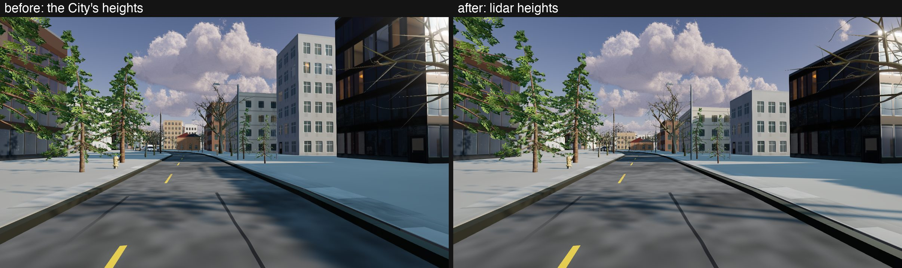
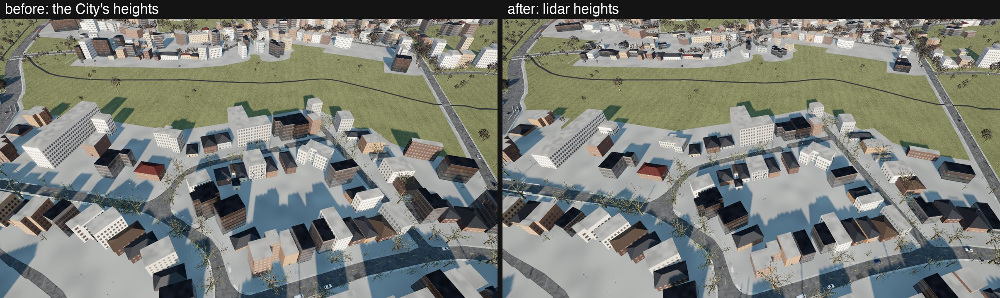
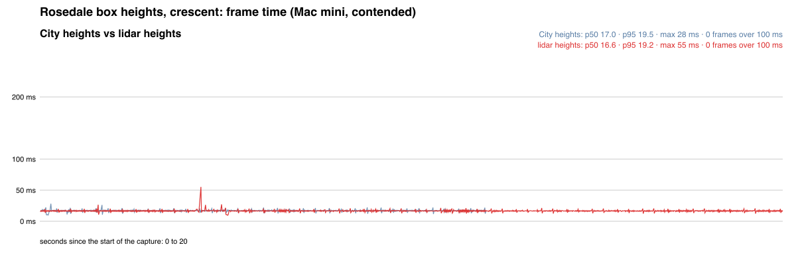
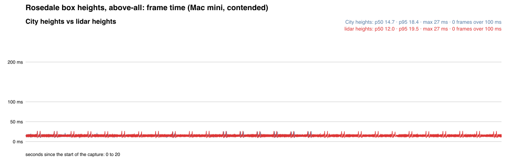

# Rosedale-Moore Park: box heights from lidar

Bead `jf-boq`, 2026-11-26. Phase 0 of [the Rosedale plan](rosedale-spike.md#8-a-phased-plan), on by default on the bigger (Eglinton) desktop map.

## What was wrong

The City's 3D Massing MAX_HEIGHT is the lidar maximum over the footprint, which takes the top of any tree that overhangs the house. The game
stands every house as a box of that height, so half of Rosedale's houses were flat-roofed boxes a median 8.1 m above their real roof
(95% more than 2 m, 80% more than 5 m): street views read as small mid-rises with grids of windows.

## What it does now

`data/frames/eglinton/rosedale-heights.bin` (4 KB) holds a new height for 3,503 box rows of the neighbourhood. `js/rosedale-heights.js` puts them in
`GEO.buildings[row][4]` in `js/main.js`, just before `buildCityBlocks` (after the massing sidecar and the presets have checked their rows, which
were built for the City's heights). Nothing else changes: the same boxes, the same triangles, one small file fetched beside the others.

| Row | New height |
|---|---|
| flat-roofed box (`roof` 0) | the lidar roof top: the 99.5th percentile of the building-class returns above the ground, `topHeight` of rosedale-roofs/1 |
| pitched or sheet-roofed box (`roof` 1, 2) | the lidar eave: the roof's height along the outline at 40% of its length from the bottom (the game puts its own hip on the walls) |

Floor 2.5 m. A row the lidar would raise keeps the City's height unless it is a house, and a house rises at most 4 m (a part standing on a podium
sees the tower above it in its footprint); a row two outlines claim takes the taller answer. The file is built by
`node tools/build-rosedale-heights.mjs <roofs.json>` from `rosedale-roofs/1` in the shared Toronto data repo (matching each house to the box rows whose
centre lies inside its outline), and `js/rosedale-heights.js` refuses it for any geodata it was not built for (a check over each row's index, centre
and height). `?rosedaleHeights=0` keeps the City's heights, for a before and after.

Measured over the 3,503 rows (`tests/rosedale-heights.test.mjs`): 3,051 lower, 282 higher, 170 unchanged; the median box falls from 14.5 m to 8.8 m
(2.5 m lower at the median row, 8.1 m lower for the 1,448 flat-roofed houses, as the spike found).

Not changed: the 227 parts inside the downtown frame that the default page already draws from outlines (they keep their heights and roofs from the
sidecar's own files: 111 houses, a later change), the 123 parts with no box row (they have no box to change), the 95 parts the lidar did not fit.

## How widespread is it elsewhere

Fourteen 300 x 300 m windows of house streets in other neighbourhoods inside the Eglinton frame (`build/canopy-sample/` in the shared data repo,
investigation `canopy-in-city-heights-sample`), 1,278 houses and semis with a lidar roof top of 12 m or less: MAX_HEIGHT exceeds the lidar roof top
by 2 m or more for **41%** of them and by 5 m or more for **26%** (median +1.3 m, 75th percentile +5.2 m; Rosedale is 57% and 41%, median +3.0 m).
It is worst where the street trees are oldest: the Beaches 60% / 55% (2 m / 5 m), the Annex 69% / 41%, Leslieville 58% / 42%; mildest in the
Junction 20% / 7%, Little Italy-Davenport 24% / 15% and Deer Park 26% / 15%. AVG_HEIGHT is 2 m or more over for only 2%: the problem is MAX_HEIGHT.
Not fixed here: those areas need the point cloud read (about 0.6 GB a square kilometre of tiles, about 70 MB a window), or the shared repo's
canopy-robust heights applied city-wide, which changes the geodata for every neighbourhood.

## Proof

Same camera, same build family, the Mac mini (Apple M4) through `gpu2` on 2026-11-26 evening, real late-November season, bare trees, 1600 x 900:





All 14 views (eight streets, the Glen Road bridge, Craigleigh Gardens, four aerials) are in John's review folder `slop-toronto-updates/2026-11-27-rosedale/heights/`
(outside the repo).

**Frame time** (`tools/frame-time-chart.mjs --overlay`, uncapped requestAnimationFrame, median frame interval in ms; the mini was shared with other jobs, so these are relative
figures, not budgets, and one recording a place and arm). Before: `?rosedaleHeights=0`, 12 s recordings on this branch's build (id 465fdd611364, dev 0b7c0fb). After:
20 s recordings of the lidar heights from the pilot's build (id 8b274b2100e9) with `?rosedalePilot=0` (the same heights code path; the pilot's own code is unused there), recorded in the
same job as the pilot's, hours after the before arm.

| Place | City heights | Lidar heights |
|---|---|---|
| Crescent Rd, street | 17.0 (p95 19.5) | 16.6 (p95 19.2) |
| South Rosedale, 160 m up | 14.3 (p95 21.3) | 14.1 (p95 21.8) |
| Whole neighbourhood, 520 m up | 14.7 (p95 18.4) | 12.0 (p95 19.5) |

No frame cost: the street and 160 m figures differ by under a frame's noise and the whole-neighbourhood view is faster (fewer tall boxes to draw).





## Reproduce

```sh
node tools/build-rosedale-heights.mjs "$TORONTO_DATA_CACHE/derived/rosedale-roofs/1/roofs.json"
node --test tests/rosedale-heights.test.mjs
JOB=views ARMS="before after" bash tools/capture-rosedale.sh   # on the Mac mini through gpu2, see the script's header
```
