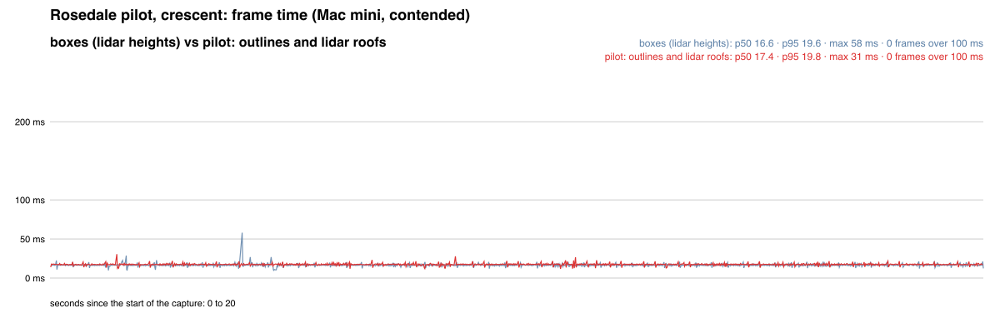
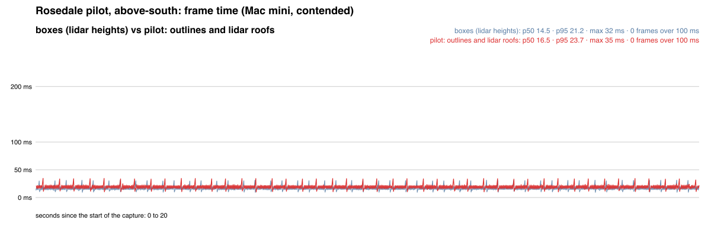
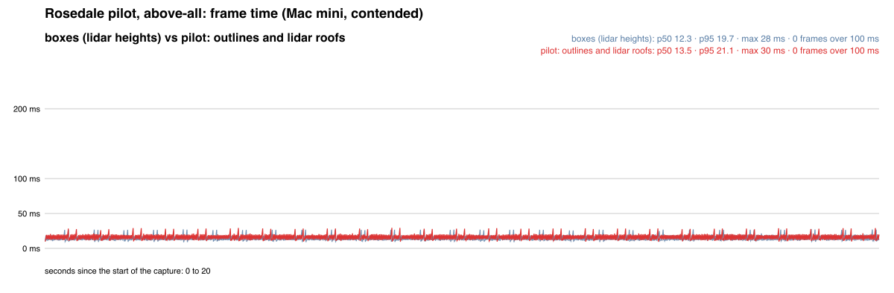
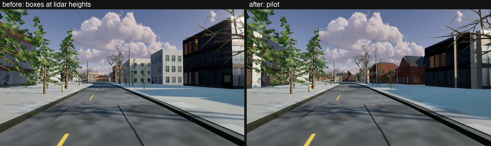
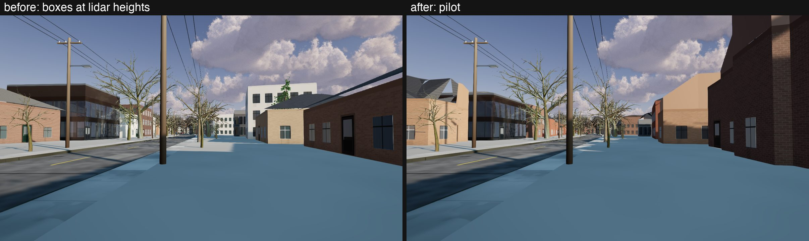

# Rosedale-Moore Park pilot: houses from their outlines with lidar roofs

> Part 2, [rosedale-walls.md](rosedale-walls.md) (2026-11-27): the houses are now drawn as house presets (porches, bays, chimneys, yards), never as curtain walls or shop fronts. The "walls are plain facade-shader walls" notes below describe this first pilot.

Bead `jf-abm`, 2026-11-26. Phases 1 and 2 of [the Rosedale plan](rosedale-spike.md#8-a-phased-plan), on by default on the bigger (Eglinton) desktop map, after
[the box heights](rosedale-heights.md). `?rosedalePilot=0` keeps the boxes (with the lidar heights; add `&rosedaleHeights=0` for the City's).

## What it does

For Rosedale-Moore Park only, every house the lidar fitted (3,471 of 3,917 parts; the 227 parts in the downtown frame stay as the page draws them) is drawn
from its own City outline instead of the box rows it stood on:

- **Outlines and walls.** `data/frames/eglinton/rosedale-houses.bin` (0.48 MB gzip, built by `tools/build-rosedale-houses.mjs`) carries each outline with the wall
  classification the massing sidecar has (party walls, hidden walls, street edges). `js/rosedale-houses.js` merges the houses into `massing.rows` in `js/main.js`
  just before the buildings are built, so `js/buildings.js` draws them as it draws every outline: walls with the facade shader (windows, doors, party walls windowless),
  a collider of the polygon (you walk round them), a far tier of the boxes. 3,411 houses are drawn this way; 79 more box rows inside the same outlines are skipped.
- **Lidar roofs, slimmed.** The 2023 lidar planes of `rosedale-roofs/1` are merged where coplanar (within 7 degrees and 0.25 m), a plane under 2.5 m2 or steeper
  than 60 degrees is absorbed into the neighbour it shares the longest border with, the borders between planes are simplified (Douglas-Peucker 0.3 m, shared
  vertices kept so no cracks open), and each facet's corners take the mean of the planes that meet there. Gable walls above the eave are cut from the roof height
  along the outline. Result: 41.1 roof triangles and 9.2 gable-wall triangles a house, 50.3 (the planner's is about 57 a building; the prototype's was about 218).
  Within 250 m of the camera a cell draws every facet; beyond, facets of 10 m2 or more and no gable walls (the existing roof-cell tiers).
- **Fallback.** Where the lidar fit was poor (coverage under 45%, held-out error over 0.5 m, or gaps over 15%: 444 houses) or the roof came out jagged (more than 8 facets,
  a roof split into pieces under a canopy: 565 houses) the game's roof planner runs on the lidar's own top and mean heights (not the City's), which gives a clean hip or
  gable. 99 houses the lidar says are flat keep a flat cap at the roof top. In the page: 2,341 lidar roofs, 982 planner roofs, 88 flat.
- **Style.** Each house's era and style code comes from the heritage data where there is a year (885 houses) and from its roof shape and the neighbourhood's era
  mix where there is not (2,586, all of Moore Park and Summerhill): the code picks the brick or render and the roof colour from the page's own palettes
  (Edwardian red and red-brown brick, revival brick and stucco with slate or cedar, Georgian red brick, Victorian dark brick and slate, Moderne and post-war buff brick,
  infill mixed). Only the derived codes are in the file: the residents' associations' ratings, years and architects stay in the shared data repo and are not republished.
  Eras in the data: before 1900 258, 1900 to 1916 1,276, 1917 to 1929 594, 1930 to 1945 480, 1946 to 1967 534, 1968 on 329. Not drawn (needs John's photos or the full preset drawing): porches, bays, dormer windows, chimneys, window rhythm per style.

## Cost

Same camera, same build, Mac mini (Apple M4) through `gpu2`, 2026-11-26 evening, 1600 x 900, uncapped, 20 s recordings (`tools/frame-time-chart.mjs --overlay`; build 8b274b2100e9 family,
shared mini, so relative figures, not budgets). Two rounds of "boxes at the lidar heights" (`?rosedalePilot=0`) against the pilot, alternating, in one job; median frame interval, ms:

| Place | Boxes (lidar heights) | Pilot | Difference |
|---|---|---|---|
| Crescent Rd, street level | 16.6 (p95 19.6) | 17.4 (p95 19.8) | +0.8 |
| South Rosedale, 160 m up | 14.5 (p95 21.2) | 16.5 (p95 23.7) | +2.0 |
| Whole neighbourhood, 520 m up | 12.3 (p95 19.7) | 13.5 (p95 21.1) | +1.2 |

The budget was no worse than +1 ms at street level: met (+0.8). At 160 m (+2.0) and over the whole neighbourhood (+1.2) the pilot costs more than the box heights did, because
3,411 houses are drawn as polygons (about 31 wall triangles a house in the near tier, the facade shader's windows) and roofs (about 50 triangles a lidar house, the planner's
hips for 982 more) where merged, instanced boxes stood; the prototype measured +3.2 ms for lidar roofs over the whole view before any slimming. Against the City's own boxes (the earlier arm of the heights runs, 17.0, 14.3 and
14.7 ms, a different hour on the shared mini) the pilot is +0.4 at the street, +2.2 at 160 m and 1.2 faster over the whole view. Triangles: near tier +105 k wall triangles; roofs about 117 k for the lidar houses. Data: 0.48 MB gzip (`rosedale-houses.bin`), fetched
beside the other files, decoded and merged in a few milliseconds before the buildings are built.







## Pictures

Six houses (115 Park Rd, 338 Douglas Dr, 4 Beaumont Rd, 83, 93 and 112 Roxborough Dr) each from 30 m along the street and from across it, and four streets (Crescent Rd,
Highland Ave, Roxborough Dr, Inglewood Dr), before (boxes at the lidar heights) and after (the pilot), are in John's review folder
`slop-toronto-updates/2026-11-27-rosedale/pilot/`. Two of them:





What reads wrong: some roofs under heavy canopy are still jagged or have a stray facet (a lidar fit under trees); the walls are plain facade-shader walls with no porch or
bay; the style is a brick or render colour and a roof colour, not a drawn style. The re-shot house views are framed from 30 m along the street and from the far side of
it, where the spike's were 12 to 40 m from the wall.

## Side effect: the patio layout

The pilot's polygon colliders in Summerhill are among the colliders near CaféTO records, so the drawn page's prebuilt patio layout (`js/frames/eglinton/toronto-patios-drawn.js`)
went stale on its collider fingerprint (the page lays the patios out at startup instead, about 43 ms in the season, and the capture harness refuses the page). It was recorded
again on the mini (`?patios=layout`, `node tools/build-patios.mjs <record> --frame eglinton-drawn`): the same 316 sites (121 sidewalk, 195 curb), a new fingerprint. Whenever
the Rosedale pilot data changes, re-record it.

## Not done

- Porches, bays, chimneys, yards and per-style facades: done in [rosedale-walls.md](rosedale-walls.md) (the houses are drawn as house presets, no curtain walls or shop fronts).
- The 227 downtown-frame parts, the 95 parts the lidar did not fit and the 123 with no box row keep what they had.
- Joined houses (semis, rows) do not share one roof colour or one eave as the presets' groups do.

## Reproduce

```sh
node tools/build-rosedale-houses.mjs "$TORONTO_DATA_CACHE/derived/rosedale-roofs/1/roofs.json" "$TORONTO_DATA_CACHE/derived/rosedale-houses/1/houses.csv"
node --test tests/rosedale-houses.test.mjs
JOB="houses frames" ARMS="heights after" bash tools/capture-rosedale.sh   # on the Mac mini through gpu2, see the script's header
```
