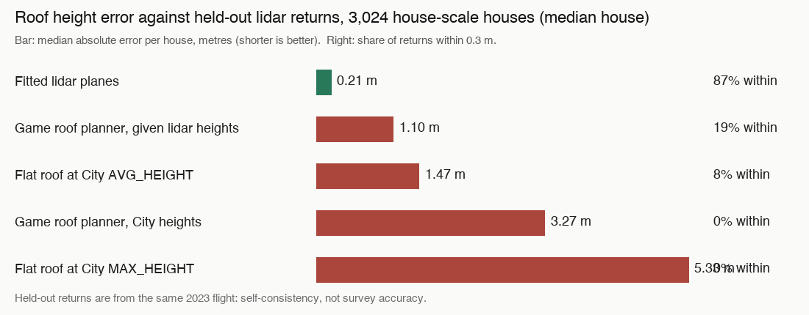
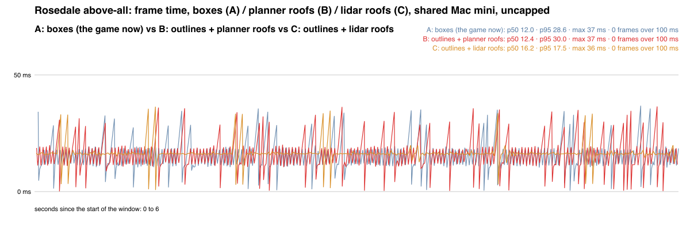

# Rosedale and Moore Park houses: a research spike

Bead `jf-5i1`, 2026-11-26. John: "Rosedale's houses are like really wrong ... each house is pretty distinctive." This is a spike: research,
measurement and small prototypes, then a plan with numbers. **No game change is shipped by default.** The prototype (`?rosedale=lidar`,
`?rosedale=skeleton`) lives on its own branch and pull request and is not merged; this document is the deliverable that is.

**Status (2026-11-26, after John's decisions):** phase 0 (box heights from lidar) shipped on by default: [rosedale-heights.md](rosedale-heights.md). The outlines and lidar
roofs pilot (phases 1 and 2) follows in its own pull request. The 15 empty 0.5 m tiles the shared fetcher stored as valid are fixed in the shared data repo
(investigation `lidar-fetcher-empty-tiles`). How widespread the canopy-in-height problem is in the other house neighbourhoods of the Eglinton map:
MAX_HEIGHT is 2 m or more over the lidar roof top for 41% of a 1,278-house sample and 5 m or more for 26% (Rosedale: 57% and 41%),
see [rosedale-heights.md](rosedale-heights.md#how-widespread-is-it-elsewhere).

Area: City neighbourhood 98, Rosedale-Moore Park, from the City's neighbourhoods layer (4.66 km²): South Rosedale, North Rosedale, Moore Park,
Summerhill and the ravines between them. Everything measured below is for that polygon. The shared data repo (private) holds the sources,
the investigation records and the datasets; paths to them are in [Data and reproducibility](#data-and-reproducibility).

## What is true now

1. **The game draws almost all of it as boxes, and the boxes are wrong in height.** Of 3,917 massing parts in the neighbourhood, 302 (111
   house-scale) fall inside the downtown frame (the strip along Bloor Street East, z ≥ −3,000 m) and are already drawn as outlines with
   presets; the other 3,615 are boxes. 98 parts (13 house-scale) have no box within 8 m of their centre at all.
2. **Half of the houses are drawn as flat-roofed boxes about 8 m too tall.** For the 3,025 house-scale houses matched to a box row, 1,517 are
   flat-roofed boxes whose top is a median 8.1 m above the lidar roof top (95% more than 2 m too tall, 80% more than 5 m). 1,505 of the 3,025
   are drawn 12 m or more tall; 315 are that tall in the lidar. The other 1,504 are pitched boxes whose walls stand a median 2.7 m under the
   lidar roof top, before the hip roof is added. The cause is the City's MAX_HEIGHT: it exceeds the lidar's building-class roof top by 2 m or
   more for 57% of the house-scale houses and by 5 m or more for 41% (median +3.0 m, p75 +8.1 m). It includes tree canopy. The street views
   below read as small mid-rises with grids of windows, which is the "really wrong" John saw.
3. **The box footprints are loose.** Against the City polygon the box's overlap (intersection over union) is a median 0.88; one house in four
   is under 0.71 and 24% are under 0.7.
4. **Roofs drawn from the City's heights are far off even where a roof is drawn.** The game's own roof planner (`js/roof-skeleton.js`) fed
   MAX and AVG height scores a median RMSE of 3.56 m against the lidar returns on a house roof; fed the lidar's own top and mean heights it
   still scores 1.52 m. Fitted lidar planes score 0.61 m (below).

Captures (the game as it is, 2026-11-26 clock and date, no season preset so the trees are bare; the Mac mini was shared, so these are
pictures, not timings) are in `$GPU2_REVIEW_DIR/rosedale-spike/` as `now--*.png`: eight streets (Crescent Rd, Elm Ave, Chestnut Park,
Highland Ave, South Dr, Roxborough Dr, Moore Ave, Inglewood Dr), the Glen Road bridge, Craigleigh Gardens (160 South Dr), and four
aerials. Copies of the best ones, with the prototype beside them, are in the review folder named under [Pictures](#pictures).

## 1. Per-house roofs from lidar

**Source.** The Ontario GTA 2023 classified point cloud (COPC LAZ on the CanElevation bucket, 1 km tiles). Over a 600 × 350 m box of South
Rosedale: 7.04 M returns, 33.5 per m²; class 1 3.77 M, ground 2.11 M, building 1.14 M (5.5 per m²), up to 8 returns a pulse; flown
2023-05-11 (GPS time), so leaf-on edge. The 12 tiles over the neighbourhood were read by HTTP range: 2,487 requests, 2.6 GB, about 35 minutes;
the ground and building returns kept are 143.9 M of 304.9 M. The City's 2015 tiles are also in the index (not used).

**The 0.5 m DSM and DTM rasters do not cover it.** The shared tile fetcher got no lidar for 15 of 16 new tiles (DSM every pixel 0.0, DTM every
pixel the no-data value) while reporting 100% valid pixels. They are marked invalid in the store manifest. The point cloud covers the same
ground and is what everything here uses.

**Method** (`build/rosedale-houses/roof_fit.py` in the shared repo, one house at a time, heights above the median ground return within 6 m):
the building-class returns inside the massing footprint and within 1.0 m outside it (eaves), not inside a neighbour, above ground + 1 m;
sequential RANSAC planes (inlier 0.12 m, slope under 80°, at least 30 returns and 5% of the house's), refit, near-coplanar planes merged; a
0.25 m grid takes the plane of its nearest labelled return; the plane regions are traced, simplified at 0.35 m, triangulated and lifted onto
their planes; the walls follow the roof height along each outline edge. The whole neighbourhood (3,917 parts) fits in about eight minutes on
the laptop while it was also serving other work.

**Results** (3,822 parts fitted; 63 have no ground return near, 25 too few returns, 6 no plane, 1 error):

| Measure | Result |
|---|---|
| Plane fit | median rms 0.041 m over 14,483 planes of 60 or more returns |
| Held-out error (20% of 1 m squares left out of the fit, scored 1 m inside the outline), 3,024 house-scale houses | per-house median MAE 0.21 m (p90 0.46), 87% of returns within 0.3 m, median RMSE 0.61 m (p90 1.14) |
| Roof planner from City MAX/AVG height, same returns | median RMSE 3.56 m (p90 11.3), 0% within 0.3 m |
| Roof planner given the lidar's own top and mean height | median RMSE 1.52 m, MAE 1.10 m, 19% within 0.3 m |
| Flat box at City MAX_HEIGHT / at AVG_HEIGHT | median RMSE 5.5 m / 1.7 m |
| Returns per m² of roof (class 6 inside the outline) | median 25.0 (p10 22.2, p90 34.9) |
| Share of 0.5 m cells inside the outline holding a roof return | median 72% (trees and shadows thin it) |
| Planes per house | median 5 (1 plane 39, 2: 148, 3: 344, 4: 740, 5: 880, 6: 587, 7 or more 316) |
| Roof triangles per house | median 146, p90 245 (the plane regions only) |
| Forms by a crude rule | hip 1,321, complex 887, gable 452, flat 393 (house-scale) |
| Main plane slope | median 35° (p25 21°, p75 42°); 1946 to 1967 houses 28°, 1930 to 1945 41.5° |
| Game's long-side ridge rule against the lidar ridge | disagrees by more than 20° on 36% of pitched houses (35% of the gables): the ridge runs across the short side |

The held-out returns come from the same flight, so this is self-consistency, not survey accuracy. The independent check is by eye against
the City's 2025 aerial photo (8 cm; review only, kept in the cache): 6 houses (5 good, 1 partial) and 12 random house-scale houses (8
good, 3 partial because a complex roof is split into extra planes, 1 failed under a dense canopy). Where the fit is good the ridge
direction and the hip or gable agree with the photo, including dormers as small extra planes. The residual-blob count (cells 0.6 m above
the planes, 3 per house at the median) is not validated as a chimney or dormer count.

**What it costs per house.** Triangles: roof regions median 146 and, with the walls, about 218 a building over the 3,468 buildings the
prototype draws (756,928 triangles); the game's roof planner draws about 57 a building (198,412); the downtown presets draw about 65 (the
massing doc: 1.27 M roof and 1.0 M wall triangles for 35,195 buildings). Data: as triangles in float32 the prototype's file is 27 MB; as
indexed triangles in decimetres the 3,054 house-scale houses are 5.3 MB, 3.4 MB gzipped (1.1 KB a house), which is too much (the downtown
sidecar is 0.87 MB for 35,254 records). Storing the plane equations and the simplified plane-region outlines instead should be in the
range of 250 to 350 bytes a house, 0.8 to 1.2 MB for the neighbourhood (an estimate, not built).

## 2. The prototype, and what it shows

`?rosedale=lidar` and `?rosedale=skeleton` draw the neighbourhood's houses from their outlines in place of their boxes (the 109 in-frame
houses stay as they are): walls plain (no windows, a small brick palette), roofs from the lidar planes, or from the roof planner over the
City's heights. It is `js/rosedale-prototype.js` plus four lines in `js/main.js` and one in `js/buildings.js` (a row-skip hook, like the
Port Lands one), on branch `rosedale-prototype`, not merged. Data files are written by `tools/rosedale-proto-build.mjs`
into `dist/data/` and not committed. No colliders: you can walk through these houses.

3,468 buildings are drawn (2,917 on the first run). Pictures: the review folder, `lidar--*.png` and `skeleton--*.png` against
`now--*.png`. On the same views the lidar roofs read as houses (hips, cross gables, dormers, porches' lean-to roofs) and the planner roofs
read as tall hip-roofed boxes, because the City's heights are still in them. The lidar walls are plain brick colours: the silhouette is right
and the facades are not. The honest result: lidar roofs fix the silhouette; they do not fix windows, porches, chimneys, materials or colour.

### Cost in frame time

Paired runs on the shared Mac mini (Apple M4, `gpu2-local`), three alternating rounds of A (the default page: boxes), B (`?rosedale=skeleton`) and
C (`?rosedale=lidar`) in the real late-November season, 1600 × 900, uncapped, six-second windows, three streets and three aerials
(`tools/shots/rosedale-cost.json`). Dev branch `rosedale-prototype` at 2afc652 on top of origin/main 9aac978; build 3c4c86eea953; the same build
serves all three arms. The mini was busy with other work, so every window is marked contended: these are relative figures, not budgets. Median frame
interval in ms (medians of the three per-round medians; the spread of the rounds is in brackets), triangles and draw calls from the renderer
(3,468 houses drawn by B and C):

| Place | A boxes | B planner roofs | C lidar roofs | C − B | triangles A / B / C (M) | draws A / B / C |
|---|---|---|---|---|---|---|
| Crescent Rd, street | 17.1 (17.0–17.1) | 16.2 (16.1–16.2) | 16.7 (16.6–16.8) | +0.5 | 5.86 / 5.82 / 6.36 | 954 / 1,035 / 1,038 |
| Highland Ave, street | 16.4 (16.4–16.5) | 14.6 (14.6–14.6) | 15.1 (15.1–15.2) | +0.5 | 5.90 / 5.86 / 6.30 | 885 / 925 / 938 |
| Inglewood Dr, street | 17.6 (17.5–17.7) | 16.6 (16.6–16.7) | 17.4 (17.3–17.4) | +0.8 | 6.93 / 6.92 / 7.55 | 973 / 1,076 / 1,061 |
| South Rosedale, 160 m up | 14.6 (14.2–16.6) | 17.3 (17.3–17.3) | 18.0 (17.9–18.0) | +0.7 | 6.30 / 6.29 / 6.85 | 884 / 964 / 971 |
| North Rosedale, 160 m up | 15.0 (14.8–15.1) | 17.9 (17.7–18.4) | 18.7 (18.7–18.8) | +0.8 | 6.38 / 6.38 / 7.01 | 825 / 907 / 906 |
| Whole neighbourhood, 520 m up | 12.0 (11.9–12.1) | 13.0 (12.3–15.2) | 16.2 (16.2–16.2) | +3.2 | 5.72 / 5.78 / 6.56 | 936 / 1,093 / 1,090 |

- **Drawing the outlines instead of the boxes** (B − A): from street level it is 0.9 to 1.8 ms *faster*, because the tall window-grid boxes that fill a
  street view are gone; from 160 m and above it is +1.0 to +3.0 ms (more draws, more triangles: 3,468 small houses against merged boxes).
- **Lidar roofs on top of the outlines** (C − B): +0.5 to +0.8 ms at street level and 160 m, +3.2 ms with the whole neighbourhood in view, for 0.4 to 0.8 M
  more triangles (756,928 against 198,412 over the 3,468 buildings, about 218 and 57 a building). The prototype's triangles are the plain
  traced regions with no far version, no culling beyond the 250 m cells, and a plain `MeshStandardMaterial`, not the game's facade shader, so the walls'
  fragment cost is understated and the roofs' triangle cost is not reduced by any level of detail; a compact roof with a far version without the
  small planes is the work in phase 2, and the target for it is C − B under 1 ms everywhere.
- For scale, the massing doc measured the default page's outlines and presets in the downtown frame at +2.0 to +3.1 ms a frame at dense places (about 65
  triangles a building, with windows, porches and dormers). Rosedale has 3,917 parts, 11% of that frame's 35,254.
- Time to attach: 22 ms (B) and 73 to 93 ms (C) of main-thread work for the meshes; the files are 5.6 and 21 to 27 MB uncompressed (a compact encoding is in
  section 1). A frame-time overlay for the whole-neighbourhood window, from the rounds' own samples, is
  `docs/images/rosedale-frame-time-above-all.png` (below): the lidar arm sits on a steady 16 ms where the other two beat between 12 and 17 ms.
  The planned 20-second frame-time recordings were not run (the mini was needed for two deploys).

## 3. Per-house style and date

The City's two heritage conservation district documents are narrative: the South Rosedale study (2002, 37 pages, E.R.A. Architects for the
residents' association) and the North Rosedale plan (2004, 52 pages, by-law 749-2004) contain no property table. The per-property data is on
the two residents' association websites: North Rosedale's WordPress REST API (827 properties: rating A/B/C/UR, construction date, an
architect id that is 0 for 797 of 817) and South Rosedale's heritage-search script (1,136 addresses with a rating A/B/C/unrated, no dates).
The City's Heritage Register (September 2026 release) adds a year (CONSTRUCTI, 757) and architect (107) to some of the 1,530 Part V rows.
Joined by normalised address to the City address points and then to the massing footprint holding each point
(`build/rosedale-houses/build.py`):

| House-scale parts (3,069) | n | with a rating | with a year | with an architect |
|---|---|---|---|---|
| North Rosedale HCD | 675 | 641 (95%) | 639 (95%) | 8 |
| South Rosedale HCD | 681 | 653 (96%) | 81 (12%) | 38 |
| Outside both HCDs (Moore Park, Summerhill, Gore lands, Mount Pleasant) | 1,713 | 0 | 28 (2%) | 12 |
| All | 3,069 | 1,294 (42%) | 748 (24%) | 58 |

Join misses: 30 of 827 North and 70 of 1,136 South rows match no address point (Castle Frank Cres, McKenzie Ave, Summerhill commercial
units); the address layer calls Binscarth Road "Bin-Scarth Rd" and lacks 17 register addresses, which the register's own coordinates fill.
Years by period (748 houses): before 1900 70, 1900 to 1916 328, 1917 to 1929 173, 1930 to 1945 120, 1946 to 1967 32, 1968 on 25. Ratings:
A 18, B 210, C 624, unrated 442. The dates are the volunteers' estimates (1910s hold 365 of 736 North Rosedale dates).

**Moore Park** is not an HCD and no study turned up: the only mention is a 2008 by-law listing it as "Potential Heritage Conservation District 73".
What covers it per house is the Heritage Register (Listed and Part IV entries only) and buildings/4's three dated sources. 56% of the
neighbourhood's houses are outside both HCDs and have nothing.

**No open source gives a style per house.** Styles are in the plans as prose by period and zone (section 5); the ratings tell importance, not look.

## 4. Materials and colour

No open source gives wall material or colour per house. The plans give it per zone: red or red-brown brick predominates, with ashlar stone
trim, light stucco and half-timber more in the Gore lands and the western streets, clinker brick for Arts and Crafts, dark slate roofs, white
clapboard in front gables (North Rosedale plan, zone sections). OpenStreetMap in the neighbourhood's box tags roof:shape on 85 buildings,
roof:colour on 35 and roof:material on 15 of about 3,900 (2%); the building:material and building:colour counts timed out. The cached OSM
extract keeps only five tags. The residents' sites carry a photograph of every property but under no open licence; Google and Bing imagery and
Street View were not used. **Houses that would most benefit from John's photos:** the 58 with a known architect and the A-rated ones (18),
because each is a distinctive silhouette the lidar already gets right, so a photo only has to supply materials, windows and the porch; the
Chapman, Eden Smith and Darling houses in North Rosedale are the best first twenty.

## 5. Lots, landscape and the ravines

From `build/rosedale-houses/lots.py` (3,069 house-scale parts):

| Measure | Median | p10 / p90 |
|---|---|---|
| Lot area (Property Boundaries parcel) | 451 m² | 261 / 845 |
| Footprint as a share of the lot | 32% | 19% / 57% |
| Lot width (short side of the lot's bounding rectangle) | 12.3 m | 7.6 / 18.9 |
| Footprint to the nearest road-surface polygon (boulevard and sidewalk included) | 11.3 m | 6.2 / 15.1 |
| Footprint to the nearest mapped sidewalk | 9.3 m | 4.4 / 19.7 |

Only 250 sidewalk polygons exist in the neighbourhood's box (the South Rosedale study describes sidewalks on both sides, on one side or on alternating sides, and grass boulevards broken by curb cuts). 347 houses hold a licensed front-yard parking permit (front yard 226, widened
driveway 119, boulevard 2). No open layer maps hedges, walls or gates (the study describes hedges, shrubberies and high masonry walls round some
properties); the City's Impermeable Surface is a 2019 raster that is no longer refreshed (not read).

**Private trees.** The City inventory is street trees only. The whole-City lidar crowns in `trees/2` cover private land: 23,028 trees in the
neighbourhood (5,168 street, 3,738 street trees matched to a crown, 14,122 lidar only), median height 14.3 m. Crown radius is capped at 12 m
and merges neighbouring crowns (median 9.4 m looks too large for a house lot), so do not read crown area as canopy cover; heights and positions
are the useful part.

**Terrain.** A 2 m bare-earth grid from the point cloud's ground class (`terrain-2m.tif`): 74.7 to 155.4 m (median 117.9 m), 10.7% of cells
steeper than 20° and 1.9% steeper than 35°. That is the Rosedale Valley, the Park Drive and Vale of Avoca ravines and the Moore Park ravine
as one surface. Slop has only the Don Valley pilot near Castle Frank. A 10 m grid like the High Park pilot (145 × 187 nodes, 307 KB) would be
about 46,600 nodes for the neighbourhood, on the order of 100 to 200 KB.

## 6. A style catalogue

The counts below are of dated houses (748, mostly North Rosedale), so they say what the North Rosedale plan's periods say. Styles are the plans'
own definitions (North Rosedale plan glossary, Blumenson, McHugh, Gowan) and the South Rosedale study's chronology. The lidar signature is
measured: the dated houses' fitted roofs grouped by period.

| # | Style | Period and share of dated houses | What reads from the street (silhouette first) | Lidar signature | Materials in the plans |
|---|---|---|---|---|---|
| 1 | Edwardian classicism and the Toronto foursquare | 1900 to 1916: 44% (328) | a cube under a hip or a shallow cross gable, deep bracketed eaves, full-width porch on brick piers with painted posts, a two-storey wood bay | hip 31%, complex 38%, gable 24%; main slope 38° | red or red-brown brick, ashlar trim, tawny and clinker brick |
| 2 | Anglo-period revivals: English Cottage, Tudor, Jacobethan | 1890 to 1930, peak 1917 to 1929 | steep cross gables, tall chimneys, half-timber and stucco in gables, an arched door | not measured by style (the dated sample has no style); the dated 1900 to 1930 roofs are 37° to 38° | brick, stucco, half-timber, slate |
| 3 | Georgian and Colonial revival, including the reduced 1930s versions | 1917 to 1929: 23% (173); 1930 to 1945: 16% (120) | a symmetrical centre-hall block, a hip or a side gable at 30° to 40°, chimneys at the gable ends, a pedimented door | 1930 to 1945: 68% hip, main slope 41.5°; 1917 to 1929: 51% hip | red brick, carefully detailed brickwork, stone door surround |
| 4 | Arts and Crafts | 1900 to 1930, scattered | a broad low roof, deep eaves, shingle or stucco upper storey, a big front gable | not separable from 1 by roof form in this data | clinker brick, shingle, stucco |
| 5 | Queen Anne and Victorian | before 1900: 9% (70) | asymmetry, a turret or bay under its own roof, steep multiple gables, half-timber in gables | complex 46%, the most triangles (204) and residual blobs (6.5), 42° | red brick, wood detail, slate |
| 6 | Richardsonian Romanesque | 1880s to 1890s, Park Road | heavy masonry, round arches, a big hip with gablets | not measured | stone and dark brick |
| 7 | Second Empire | one-offs (3 Meredith Crescent, 1876) | a mansard roof and a portico | beyond the 9-plane cap (not measured) | stone or brick, slate |
| 8 | Early Georgian and Regency villas | before 1870 (124 Park Road, 1857) | a low symmetrical block on a big lot, a hip, verandah | not measured | stucco or brick |
| 9 | Bungalows | 1900 to 1945, Standish and Glen | low, a full-width veranda, a low gable | not measured | brick and wood, stone |
| 10 | Art Deco and Moderne | 1930s, Astley Avenue | a flat or near-flat roof, a brick box, curved corners | flat 3% of the 1930 to 1945 houses | brick |
| 11 | Post-war: ranch and Dominion modern | 1946 to 1967: 4% (32) | low horizontal, a low hip or flat, a garage | main slope 28°, flat 31% | brick, wood, glass |
| 12 | Revival infill and contemporary | 1968 on: 3% (25) | revival silhouettes from the 1970s on (17 Chestnut Park, 1992) or glass boxes (105 Glen Road, 2002) | slope 29°, hip 50%, flat 17% | varies |

Not houses but needed: low-rise courtyard and 1950s modernist apartments (228 parts), and the semis and rows of the Gore lands, Summerhill
and Moore Park (18.8% of house-scale parts are semi or row; Moore Park's are the same Edwardian row types the downtown presets already have).

**How they plug in.** `js/building-prototypes.js` today has 13 house presets by attachment (detached, semi, row) and era with random range;
none is keyed to a roof. The plan: keep the presets for facades, porches and window rhythm, and let a lidar roof replace the roof the preset
would plan (the roof is the part the City's heights get most wrong), with style chosen from the dated era where there is one, the HCD zone,
the footprint and the roof's own form (steep and many-planed means 2, 5 or 6; hip with a symmetrical plan means 3; low and flat means 10 or
11). The three periods behind styles 1 to 3 hold 83% of the dated houses (1900 to 1945), but the dates cannot split a period into its styles: that needs the roof form, the plan and John's photos.

## 7. Cost

See "Cost in frame time" in section 2 for the measured numbers. Data cost is in section 1 (file size per house). Build cost: the heritage join and the lots run in under a minute each, the lidar read is about 35 minutes of network (2.6 GB), the roof fit about 8 minutes, the prototype data a few seconds.

## 8. A phased plan

Effort is in sessions of one agent working a day-part, from what the existing builders cost (the massing sidecar, the High Park terrain pilot
and the presets each took two to four). Frame costs are from section 2's paired runs on the shared Mac mini (relative evidence, not budgets).

| Phase | What | Effort | Data | Frame cost | Fixes |
|---|---|---|---|---|---|
| 0 | **Box heights from lidar** in the neighbourhood. One height per massing part (the lidar roof top, or the eave for a pitched box) replaces the City's tree-inflated MAX_HEIGHT for the 3,917 rows; matched by row like the prototype's skip list. | 0.5 to 1 | about 8 KB (one 16-bit value a part) | none: the same boxes, fewer tall ones (fewer triangles) | the 1,517 flat boxes a median 8.1 m too tall; the "mid-rise" look. Not the roofs, windows or materials |
| 1 | **Outlines and the roof planner outside the downtown frame**, Rosedale first: extend `tools/build-massing.mjs` and the presets planner to the bigger map's Rosedale rows (the sidecar is keyed to the downtown frame today; the tool already takes another geodata with --geo and --frame). Heights from phase 0, not MAX_HEIGHT. | 2 to 3 | sidecar and presets files grow by about 11% (3,917 of 35,254 records): roughly 0.1 MB | B − A in the paired runs: −0.9 to −1.8 ms at street level, +1.0 to +3.0 ms from 160 m up (plain walls; the real presets add windows, porches and dormers) | footprints (24% of boxes under 0.7 overlap), party walls, the Bloor strip's seam |
| 2 | **Lidar roofs**: write the planes and region outlines compactly (not the triangles), a loader, a roof override in the massing cell and the house drawing code, a far version without the small planes. Replace the planner's roof for every house that has a fit. | 2 to 3 | 0.8 to 1.2 MB estimated (the prototype's triangles are 3.4 MB gzipped, too big) | C − B in the paired runs: +0.5 to +0.8 ms at street level and 160 m, +3.2 ms over the whole neighbourhood, before any level of detail; target under 1 ms | the roof forms: hips, cross gables, dormers, the 36% of ridges the long-side rule turns the wrong way |
| 3 | **Era, rating and style layer**: year, rating and zone per house from `rosedale-houses/1` choose a style (section 6) and a palette; Moore Park (no inventory) takes era from the neighbourhood's census mix and form. Style picks facade, porch, window rhythm and wall colour; roofs stay lidar. | 2 | about 16 KB (year, rating, style a part) | none beyond phase 1 | each street reading as its period; Moore Park reading differently from North Rosedale |
| 4 | **Lots and landscape**: licensed front-yard pads and widened drives from the permit list, lawns and front walks by setback, hedges and low walls by rule on A and B rated houses, private trees from `trees/2` (heights and positions are good; the crown radius is not), boulevards and the alternating sidewalks. | 2 | small; tree crowns already exist as lidar trees on the bigger map (not checked for Rosedale) | trees and hedges are the cost: measure with the same runs | the bare lots between houses |
| 5 | **Ravine terrain pilot** like High Park: the 2 m grid is built; a 10 m grid of about 46,600 nodes (100 to 200 KB) under the Rosedale Valley, Park Drive, Vale of Avoca and Moore Park ravines, with the Glen Road, Park Drive and Bloor bridges placed on it. | 2 to 3 | 100 to 200 KB | the Don Valley pilot drew 24 draped meshes (20,203 triangles) in about 0.47 s of build; per-frame cost not measured here | the flat ground under a neighbourhood that is defined by its ravines |
| 6 | **John's photos** for the distinctive houses (the 58 with an architect, the 18 rated A, the HCD plans' showcase houses): materials, windows and the porch per house on top of the lidar roof. No paid generation. | about 0.1 per house | per-house parameters | negligible | the last 10% |

Ordering: 0 first and alone (cheap, and it removes the worst of what John saw). Then 1 and 2 together as one Rosedale pilot, because phase 1 without
phase 2 puts the planner's wrong roofs on correct outlines. Then 3, with 4 and 5 as the next two. Going beyond Rosedale: the point-cloud read cost
2.6 GB and about 35 minutes for 12 tiles (8.8 km² of tiles for a 4.66 km² neighbourhood), so the bigger map's roughly 190 km² would be 50 to 110 GB and
many hours of network; it needs a list of areas worth it, not a blanket run. The roof fit itself is fast (about 8 minutes for 3,917 parts).

## Pictures

In John's review folder `slop-toronto-updates/2026-11-26-rosedale/` (outside the repo): `house-<address>.png`, one per house: the
photo, the game now, the game's roof planner over the City heights, and the lidar roofs, street level and oblique, with the City's 2025 aerial
beside the oblique row; `roof-error-by-method.png` (the chart in section 1); the streets and aerials as `now--*`, `skeleton--*`, `lidar--*` in
`$GPU2_REVIEW_DIR/rosedale-spike/`. Photo credits: 115 Park Rd, Randal Oulton, Wikimedia Commons, CC BY-SA 4.0. The five North Rosedale houses'
photos are the plan's own figures (E.R.A. Architects, 2004; licence not stated: internal review only). The City's 2025 aerial is for review only
(licence unverified). Dark patches on the lidar roofs are most likely the low November sun and the shadows of the game's own tree models, which stand over some houses; the fitted triangles cover 99% of every outline's area (median 98.9%, 5th percentile 97.8%), so they are not holes in the data. The street-level row of the house sheets was framed too close (12 to 40 m); the oblique row is the useful one.

## Data and reproducibility

In the shared repo (private), investigations in `registry/investigations/`: `rosedale-hcd-inventories`, `rosedale-moore-park-heritage`,
`rosedale-house-style-open-data`, `rosedale-lots-landscape`, `rosedale-lidar-roofs`, `rosedale-ravine-terrain`; sources in
`registry/sources.json` (the two HCD documents, the two residents' lists, front-yard parking, and updates to the point cloud, DSM/DTM,
property boundaries, orthophoto, heritage register and Commons entries); datasets in `registry/datasets.json`: `rosedale-houses/1`,
`rosedale-roofs/1`, `rosedale-lidar-points/1`. Builders are in `build/rosedale-houses/` with a README. In this repo (prototype branch):
`js/rosedale-prototype.js`, `tools/rosedale-roof-compare.mjs`, `tools/rosedale-proto-build.mjs`, `tools/capture-rosedale.sh` and the shot lists
`tools/shots/rosedale-*.json`.

## Decisions for John

1. **Fix the Rosedale box heights from lidar now (phase 0)?** Recommended: yes, by default, no query parameter. It is data only, costs no frame time and removes the mid-rise look from half the houses. Alternative: apply the shared repo's canopy-robust heights city-wide, which changes the geodata for every neighbourhood.
2. **Then build outlines and lidar roofs together for Rosedale as a pilot (phases 1 and 2)?** Recommended: yes. The prototype's roofs are 5 to 15 times closer to the lidar than the planner's, at about four times the triangles of the planner's roofs (218 against 57 a building), which the compact version has to bring down. The alternative is outlines with the planner only, which keeps wrong roofs.
3. **Moore Park has no heritage inventory.** Accept an era-and-form fallback there (the same presets as downtown), or give photos of the streets you care about most?
4. **Which houses get your photos first?** Suggested: the six in the pictures (115 Park Rd, 338 Douglas Dr, 4 Beaumont Rd, 83, 93 and 112 Roxborough Dr), then the A-rated South Rosedale houses.
5. **Ratepayer data is not open-licensed.** The ratings, years and architects come from the two residents' association websites. Fine to use inside the game's data (not republished), or ask the associations first?
6. **Extend lidar roofs beyond Rosedale?** Not without a list of areas; the read costs about 0.6 GB a square kilometre of tiles.
