# Rosedale streetscape: from John's own photos

Bead `jf-qw7`, 2026-11-27. John's three own photographs of Rosedale (Chestnut Park on 22 October and 22 November 2020, and a Rosedale street on 2 October 2020) show what the game gets wrong there.
The photographs are private: they are not in this repository, and nothing here copies them. What they show, in words:

- **Chestnut Park, 22 October:** a narrow winding road with no painted lines, a low concrete curb, black cast-iron lamp posts about 4 m tall with a white globe on top, one on each side every 25 to 30 m; wide grass
  boulevards with a paved walk behind them; huge mature street trees (ash, maple, honey locust) arching over the whole road; clipped hedges (low boxwood along the walks and beds, tall dense hedges on the lot lines); a red
  Japanese maple in a front yard; a brick-paved drive; brown paper leaf bags standing at the curb; fallen leaves on the road and the lawns; a parked car at the end of a drive.
- **Chestnut Park, 22 November:** the same bend in snow: snow on hedges and branches, the posts and globes with snow caps, boulders (large rough reddish sandstone ones in a row, and grey granite ones) along the curb and at lawn corners and drive
  mouths, cars parked in the drives.
- **A Rosedale street, 2 October:** the road's edge is a plain concrete curb, the boulevard a wide strip of lawn with a few large grey boulders, big trees right at the curb, an ivy-covered brick house, tall clipped hedges against the
  walls and along the lot lines, small black lamp posts with globes in the distance, overhead wires.

> Part 1 (centre lines, lamp posts, boulders) shipped as PR #248; part 2 (this section's second half, "Part 2") is below it.

## PR 1: quick wins (centre lines, lamp posts, boulders)

### 1. No centre line on local streets

The page painted a yellow dashed centre line on every two-way street. `js/road-paint.js` now leaves it off a **local street**: one whose OSM class is residential, unclassified or a living street (road-network `rank` 1 or less) and whose carriageway is
under 10 m (half under 5 m). `js/road-network.js` carries `rank` into `paintEdges` (the downtown grid's own streets have none and keep their line).

Real practice: Toronto paints centre lines on its collector and arterial roads and not on local residential streets, which is why Chestnut Park's road is bare in the photographs. The City's Centreline (`FEATURE_CODE_DESC`: Local, Collector, Minor Arterial, Major Arterial)
is the source of truth for that class, but the page's road graph is OpenStreetMap's. Joining the two over 12,000 sampled points on residential roads (shared data cache, `centreline.csv`): **87% Local, 9% Collector, 4% other**; OSM tertiary roads are Collector 45%
and Minor Arterial 48%. So the OSM class is a good proxy: residential and unclassified roads lose the line, tertiary and above keep it. Crescent Rd is OSM tertiary and a City Collector, so it keeps its line; Chestnut Park, Roxborough Dr, Elm Ave's residential
stretches, Glen Rd and Rosedale Rd lose theirs. Citywide it is 6,105 residential and 228 unclassified road pieces of the Eglinton frame.

Limit: about one residential piece in ten is a City Collector, which now has no line; a per-street City class in the geodata would settle it (a data rebuild, not done here).

### 2. Rosedale's lamp posts

The City maps the lamps as ordinary "street light poles" and "pedestrian light poles" with no height or look, so nothing in its data tells Rosedale's posts from a cobra-head on a hydro pole. The rule is therefore by place: `tools/build-rosedale-zone.mjs`
makes `js/rosedale-zone.js`, a 20 m mask (4,345 cells, 2 KB) of everything within 34 m of a house in the South or North Rosedale Heritage Conservation District (1,518 houses from the shared data repo's `rosedale-houses/1`, joined to the pilot's `rosedale-houses.bin`), closed
over the street gaps. 133 of Moore Park's and Summerhill's 1,953 untagged houses lie inside the mask at its edge. A mapped street light or pedestrian light in the mask, on a street that is no more than a collector (OSM rank 2 or less), is drawn as the new look
`globe` (`js/mapped-poles.js`): a 4 m black cast-iron post (fluted base, tapering shaft, a ring, a cup) with a white opal globe that glows at night and casts a lamp pool (`street-details.js`). Where the City mapped no light in the zone the procedural fill (a tall grey pole) is now
skipped. The 9 m light and signal poles at junctions keep their shape. `?rosedaleStreet=0` keeps the old poles.

### 3. Boulders

`js/front-yards.js`: grey granite and reddish sandstone boulders in the boulevard, found by marching out from the lot line to the road's pavement edge (`edgeAt`, from `nearestRoads`' width), 0.4 m behind the curb: at the mouth of a drive (half the time each side), at the lot's
corner (30%), now and then one in the middle of the frontage, and on one lot in ten a row of three to five. Each is a 20-triangle flat-shaded icosahedron pushed about, sunk a third into the ground, drawn with the yard material (kind 12: speckle and streaks, a snow cap in
winter). A stable seed per house, so a rock is where it was on every load. Rosedale styles only.

## Pictures

Same camera before (origin/main `0441144`) and after, on the Mac mini, 1600 x 900, no season preset: 22 October 2026 (autumn colour) and 22 November 2026 with 6 cm of snow, the dates of John's two Chestnut Park photographs. Side-by-side sheets with his photos
are in his private review folder (`slop-toronto-updates/2026-11-27-rosedale-streetscape/`); the pictures here are the game's frames only.

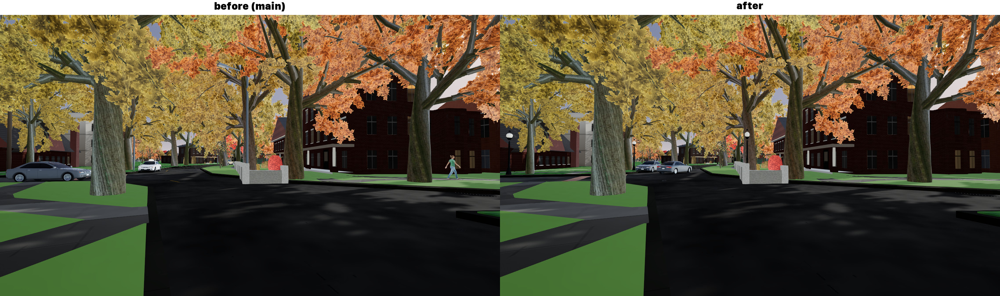


## Cost

Mac mini (Apple M4) through `gpu2`, shared with a production transcription job (relative, not budgets), 1600 x 900, uncapped, 20 s recordings, today's date (bare trees), origin/main `0441144` against `5396df0`, alternated
(round 2 ran "after" first). Mean / median frame interval, ms, before -> after, at street level (budget +0.5 ms):

| Place | Round 1 | Round 2 (after first) |
|---|---|---|
| Chestnut Park | 19.04 -> 19.07 (+0.04) / 19.00 -> 19.10 | 19.07 -> 19.10 (+0.03) / 19.00 -> 19.10 |
| Crescent Rd | 16.45 -> 16.22 (-0.23) / 16.40 -> 16.20 | 16.27 -> 16.23 (-0.03) / 16.20 -> 16.20 |

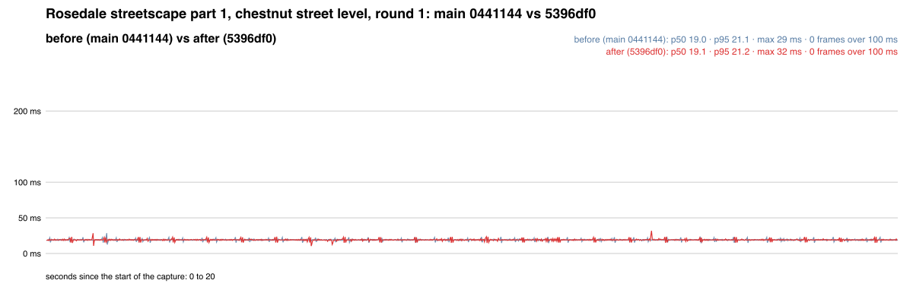


## What is still wrong

- A City Collector that OpenStreetMap calls residential (about 1 in 10 residential road pieces) loses its centre line; a per-street City class in the geodata would settle it.
- The lamp zone is the two Heritage Conservation Districts: North Rosedale's lamps were assumed to match South Rosedale's (the photographs are of Chestnut Park, South Rosedale). The City maps no height or look, so there is no data to check against.
- Boulders are a rule (a stable seed per lot), not a survey; their number follows what the photographs show, not a count.

## Reproduce

```sh
node tools/build-rosedale-zone.mjs ~/.cache/toronto-data/derived/rosedale-houses/1/houses.csv   # js/rosedale-zone.js
node --test tests/rosedale-streetscape.test.mjs tests/road-paint-cells.test.mjs tests/front-yards.test.mjs tests/mapped-poles.test.mjs
SHOTS=tools/shots/rosedale-streetscape.json ARMS="beforeFall afterFall beforeSnow afterSnow" bash tools/capture-rosedale-streetscape.sh   # on the Mac mini through gpu2
```

## Part 2: leaf bags, fallen leaves, paver drives, red maples

What the photographs show that part 1 did not touch, and what was done (`js/front-yards.js`, `js/front-yard-material.js`; the yard mesh, drawn within 250 m, so the cost is the yards' own):

| In the photographs | Now |
|---|---|
| Brown paper leaf bags standing at the curb, two or three together | `leafBag`: a kraft-paper bag (a body 0.46 x 0.3 m that bellies out, the top gathered in and folded, 26 triangles) in a group of two or three beside a drive's mouth or on the frontage, on 38% of Rosedale lots (42% of the grand ones; 8 to 15% elsewhere). **Seasonal in the material** (kind 14): there from the autumn colour's peak (mid October) to the first of December, none under snow, so a date change is uniform writes only |
| Leaves lying on the grass and the boulevard | The lawn kind has fallen leaves in it, and each lot's boulevard (lot line to curb, found as for the boulders) has a ragged patch of them (kind 16): two layers of oriented elliptical leaves on jittered cells, yellow, orange, brown and the odd red, thicker in patches, from the colour's peak until the snow or the first of December. Not on the road: the road is another shared material |
| Drives in interlocking pavers | A drive is paved (kind 13) on 55% of Rosedale lots (70% of the grand ones): a running bond of 20 x 10 cm blocks along the house's own axes, joints, a tone a block (charcoal, grey, brown-grey, terracotta), snow on top, a mean colour past a few metres |
| Red Japanese maples in front yards in autumn | The ornamental tree is more often there (0.2 and 0.26 a lot, was 0.1 and 0.14) and nine times in seventeen a Japanese maple (was 4 in 12); its leaf cards (kind 15) are deep red in summer, **crimson in autumn**, then bare |

Pictures (same camera before and after, 22 October 2026): see the sheets in John's review folder (`slop-toronto-updates/2026-11-27-rosedale-streetscape/part2/`).

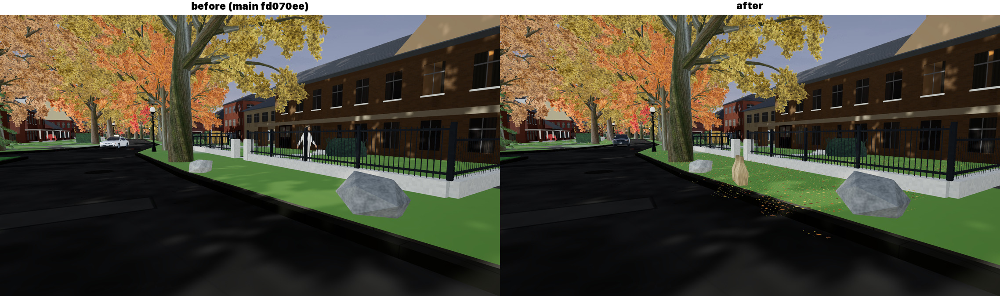

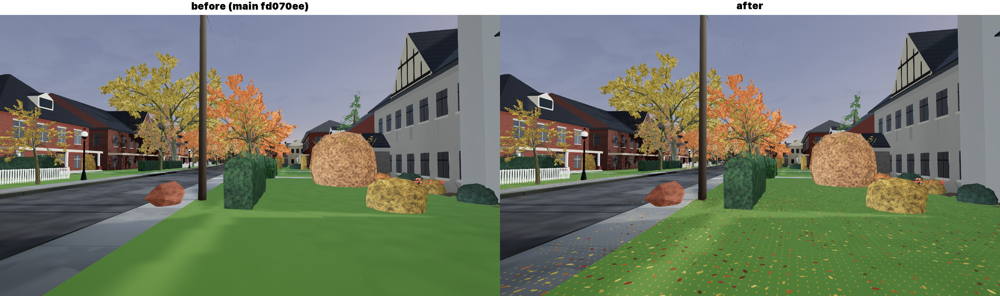

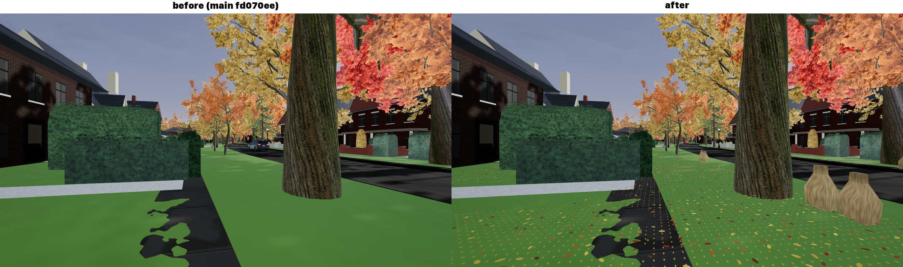

### Cost of part 2

Mac mini (Apple M4) through `gpu2`, shared with a production transcription job (relative figures), 1600 x 900, uncapped, 20 s recordings at street level, main `fd070ee` (part 1 live) against part 2, alternated. Mean / median frame interval, ms, before -> after (budget +0.5 ms):

| Place | Date | Round 1 | Round 2 (after first) |
|---|---|---|---|
| Chestnut Park | 26 Nov (bare) | 19.13 -> 19.09 (-0.04) / 19.10 -> 19.10 | 19.10 -> 19.15 (+0.05) / 19.10 -> 19.20 |
| Crescent Rd | 26 Nov (bare) | 16.47 -> 16.33 (-0.15) / 16.50 -> 16.40 | 16.31 -> 16.34 (+0.03) / 16.30 -> 16.40 |
| Chestnut Park | 22 Oct (bags, leaves, maples) | 18.05 -> 18.07 (+0.02) / 18.00 -> 18.00 | |
| Crescent Rd | 22 Oct | 15.71 -> 15.81 (+0.10) / 15.70 -> 15.90 | |

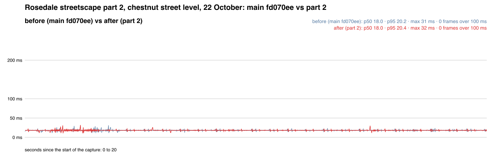

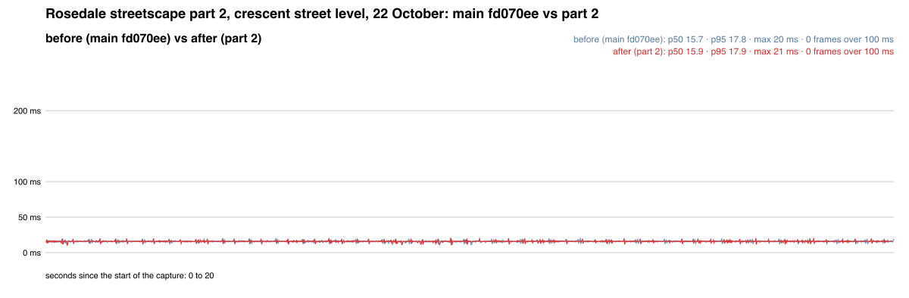

### Looked at and left

- **Street trees.** The page sizes a City street tree from its trunk diameter: 4 m + 0.28 m a centimetre, capped at 26 m, and the EZ-Tree model scales to that. Chestnut Park: 131 trees within 22 m of the road; 27 stand at the 26 m cap (diameter 79 cm or more), the median is about 16 m. In the frames they arch over the road as in the photographs; nothing changed. (The cap, not the scale, is what a 100 cm oak runs into; the data has no tree higher than 26 m.)
- **Hedges.** The lidar hedges (docs/front-yards.md) already put tall clipped hedges on lot lines; nothing changed.
- **Ivy on house walls**, **cars parked in drives** and **leaves on the road** were not done: ivy needs a per-house facade colour that follows the season (green in summer, red then bare), a parked car in a drive needs a place in the parked-car layout, and the road's leaves live in the shared road material another agent is changing.
- Snow on hedges and branches is already there (evergreens take a snow cap, deciduous shrubs and trees go bare and take snow on top).

## Part 3: the road's colour, the lawns, fallen leaves on the road (bead `jf-bv3`)

John's four complaints after part 2, with the two he chose first (the road and the lawns) done here; the lot lines and the road's shape are in the next section. The photographs are private and not in this repository.

### 1. Why the road was near black

Measured on the same Chestnut Park frame (22 October, overcast), the mean of a 400 x 200 patch of roadway: **John's photograph (83, 78, 78)** (a soft mid grey, lighter and a little patchy, leaves on it), the game **(11, 12, 14)**, Crescent Rd's road in the game (76, 82, 89).
So it is not the asphalt's albedo (a mid grey, `js/tsl-materials.js` `createRoadSurfaceMaterial`), and it is not wetness either: with the road's wetness set to 0.05 the patch went from 16 to 11 (a dry road is less glossy, not lighter). Turning the tree crowns out of the sky-occlusion map (`SkyOcclusion.setLeaf(0)`) took it to **53**.

The cause is `js/sky-occlusion.js`: while the trees are in leaf (`uLeaf` 0.5 or more) each crown is a solid disc in the height map reaching `CROWN_SHARE` = 0.65 of the tree's height. A 16 m street tree is a ceiling 10 m up over the road, and a road lined with them sees almost no sky: the same
reason the concrete walks under such trees came out near black (the boulevard frame). Trying shares of 0.65, 0.45, 0.3 and 0.2 on the same frame (road patch 11, 21 to 29, 44 to 46, 53) and radius scales of 0.7 and 1, the share is now **0.25**, about the height of a crown's underside:
the leaves still shade the street, but a roadway under them reads as a grey road (58, 65, 74 on the frame, from 11, 12, 14). The asphalt's two tones are also a few percent lighter (`0x4b4946` and `0x777571`, were `0x474542` and `0x716f6b`) and its patchy mottling a little stronger.
Downtown and the arterials have no crowns over them and move only by that lightening (see the pictures).

### 2. Fallen leaves on the road

Leaves lie on the asphalt from the colour's peak until the snow or the end of November (`leafFallSeason` in `js/tsl-materials.js`: a third of the year's fall while the crowns are still full, all of it once they are bare), oriented elliptical leaves in yellow, orange, brown and the odd red, a few on any street and
thicker under the trees. "Under the trees" is read from a new **crown cover** map (`crownCoverGrid`, `crownCoverNode` in `js/sky-occlusion.js`): the same 245,766 crowns as the sky occlusion's, as a soft 0 to 1 cover on a texel of 8 m, 3.3 MB, one texture sample; the road, the lawns and
the yards share it. The leaves are skipped outright beyond 30 m (45 m on a lawn), by a uniform test first, so a summer or a bare winter road pays nothing for them.

Along the way the yards' leaf code was fixed: it hashed the leaf cell's number whole, and at Rosedale's world coordinates (cells numbered in the millions) the GPU's sine returned something close to a constant for one of its two layers, so every cell of that layer held a small yellow dot: **a regular lattice of yellow dots over the lawns and the boulevard patches** (in the part 2 frames, and on the snow
frame before this PR). The one function, `leafScatter`, now serves the road, the plot ground, the lawns and the yards' litter, with the cell wrapped before it is hashed; its leaves are also bigger (about 10 to 17 cm long, they were 6 to 9) so they read at street level.

### 3. Lawns

`groundLawn` (`js/tsl-materials.js`) is the one lawn colour, used by the plot ground (the verges, boulevards and yards, `createPlotGroundMaterial`) and by the yards' lawn patches (`js/front-yard-material.js` kind 3), so a lawn and the ground beside it are one grass. It was two noises of the same two greens and read as a flat saturated green. Now:

- patches a few metres across, a little lighter or darker (a 0.77 to 1.23 factor), and sun-dried yellow patches;
- faint mowing stripes (4.5%, a 1.16 m wavelength, their direction changing from lot to lot), close up only (they fade out by 60 m);
- under a crown, while the trees are in leaf: 32% darker, and thin, a patch of the ground showing through (a brown);
- the autumn's leaves lying on it, thickest under the trees;
- the season's colours as before (`seasonalGrass`: dormant turf, spring's yellow-green), snow over all of it.

The crown map is read only while the trees are in leaf or the leaves lie (a uniform branch), so the bare winter lawn pays for the patches and stripes only.

## Pictures (part 3)

Same cameras before (origin/main `aca2514`) and after, on the Mac mini, 1600 x 900, no season preset: 22 October 2026 and 22 November 2026 with 6 cm of snow. Side-by-side sheets with John's photographs are in his private review folder (`slop-toronto-updates/2026-11-27-rosedale-streetscape-3/partA/`);
the pictures here are the game's frames only.

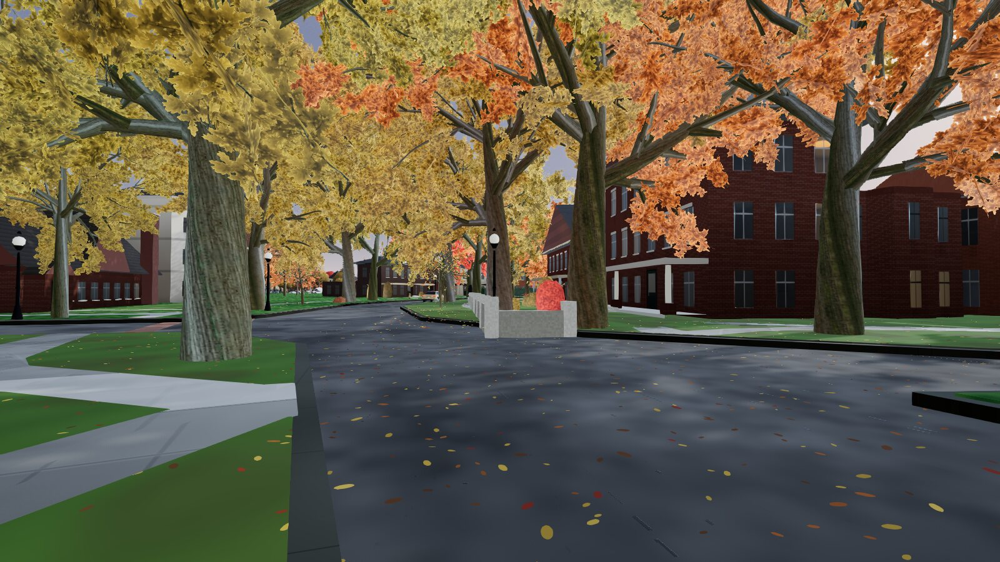

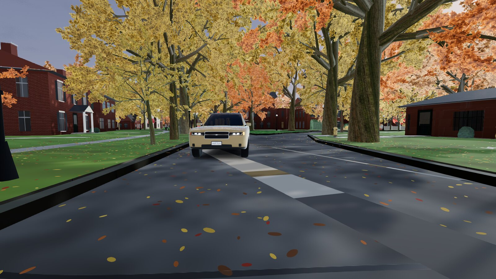

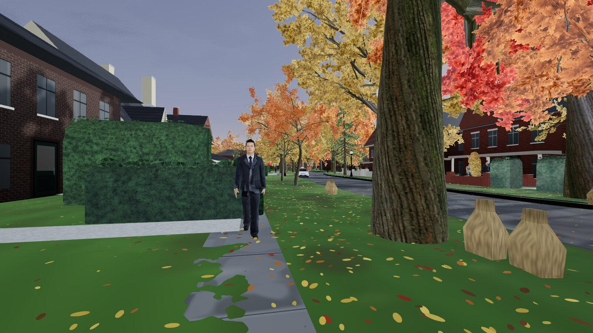

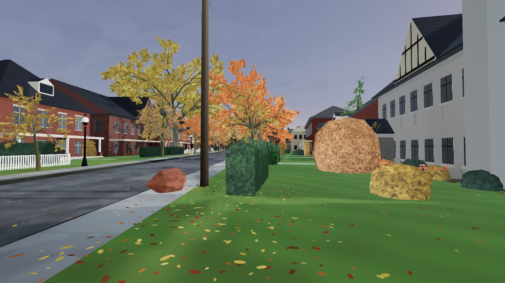

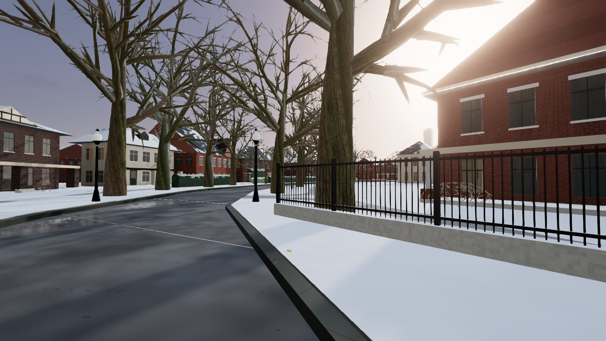

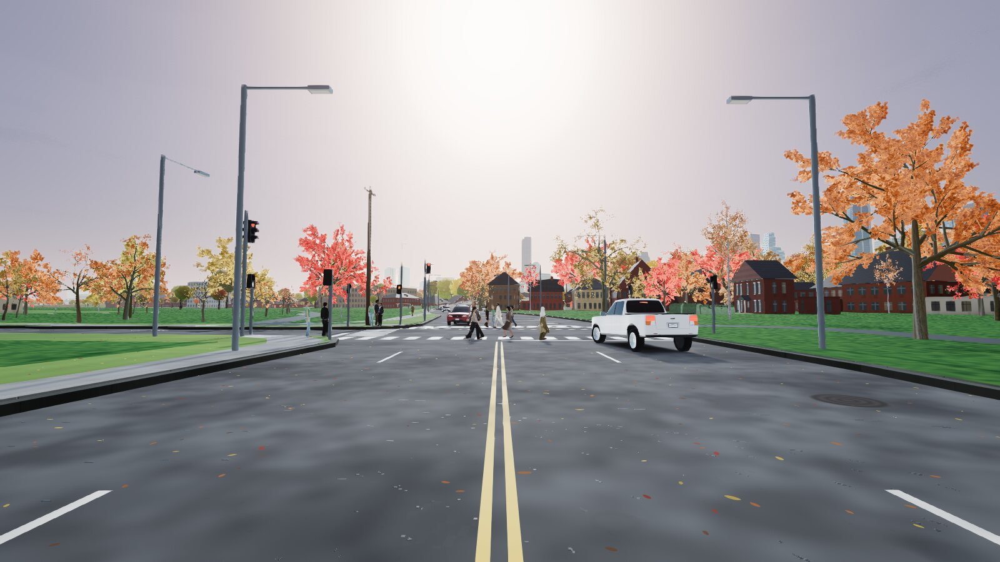

### Cost of part 3 (road colour, lawns, leaves on the road)

Mac mini (Apple M4) through `gpu2`, shared with a production transcription job (relative figures, not budgets), 1600 x 900, uncapped, 20 s recordings at street level (the first 15% of each dropped), origin/main `aca2514` against this branch, alternated (every second run had "after" first).
Mean / median frame interval, ms, before -> after (budget +0.5 ms at street level):

| Place | Date | Run | Mean | Median |
|---|---|---|---|---|
| Chestnut Park | 22 Oct | 7 | 18.13 -> 18.26 (+0.13) | 18.10 -> 18.20 (+0.10) |
| Chestnut Park | 22 Oct | 8 (after first) | 18.08 -> 18.23 (+0.15) | 18.10 -> 18.30 (+0.20) |
| Crescent Rd | 22 Oct | 7 | 15.98 -> 16.00 (+0.03) | 16.00 -> 16.00 (+0.00) |
| Crescent Rd | 22 Oct | 8 (after first) | 15.79 -> 15.99 (+0.20) | 15.80 -> 16.00 (+0.20) |
| Chestnut Park | 26 Nov (bare) | 5 | 19.08 -> 19.31 (+0.24) | 19.10 -> 19.30 (+0.20) |
| Chestnut Park | 26 Nov (bare) | 6 (after first) | 19.14 -> 19.33 (+0.19) | 19.10 -> 19.30 (+0.20) |
| Crescent Rd | 26 Nov (bare) | 5 | 16.40 -> 16.50 (+0.11) | 16.30 -> 16.50 (+0.20) |
| Crescent Rd | 26 Nov (bare) | 6 (after first) | 16.35 -> 16.47 (+0.12) | 16.30 -> 16.40 (+0.10) |

Those are the final build. An earlier build of the same change (the crown map read on every lawn fragment, even in a bare winter) measured +0.13 to +0.20 in October and, in one of two bare-date runs, +1.1 and +0.7 (the other of that pair +0.2 and +0.1): the crown map
and the shade are now behind a uniform test that is false when the trees are bare and no leaves lie (`crownsMatter` in `groundLawn`). The extra ground work is one texture sample and about four noise lookups on a lawn fragment, and on a road fragment only the uniform test out of season.

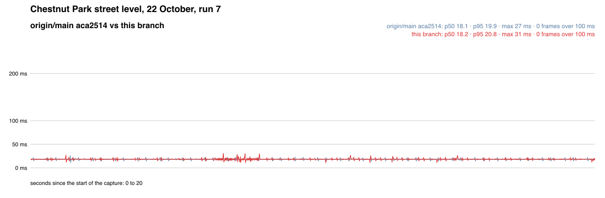

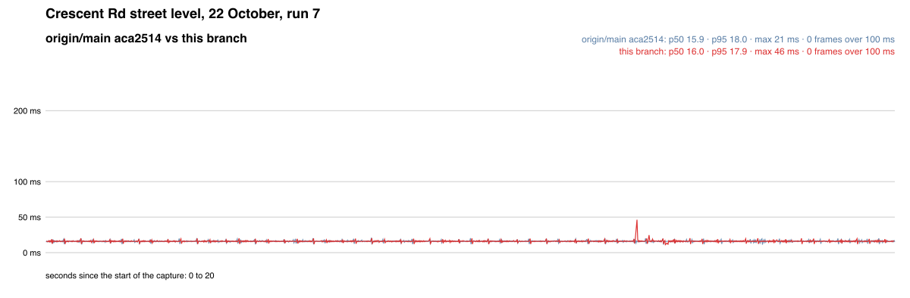

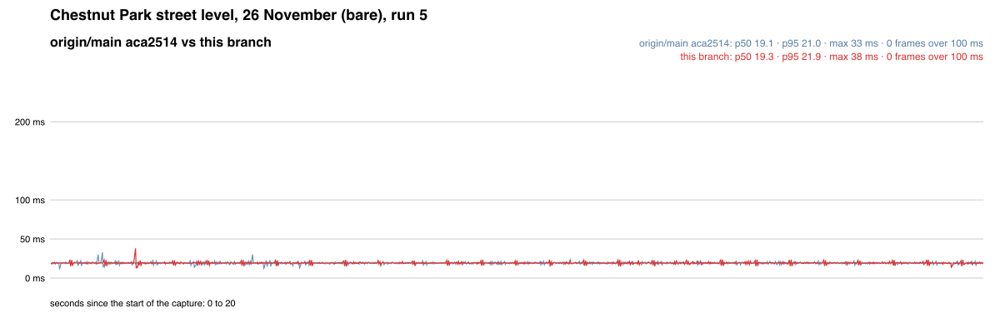

### Reproduce

```sh
node --test tests/sky-occlusion.test.mjs tests/ground-mask-guard.test.mjs
SHOTS=tools/shots/rosedale-streetscape-3.json ARMS="beforeFall afterFall beforeSnow afterSnow" bash tools/capture-rosedale-streetscape.sh   # on the Mac mini through gpu2
FT=1 ROUND=1 ARMS="beforeFall afterFall" bash tools/capture-rosedale-streetscape.sh                                                  # frame times
```
