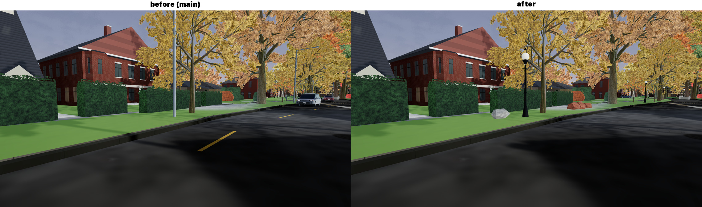
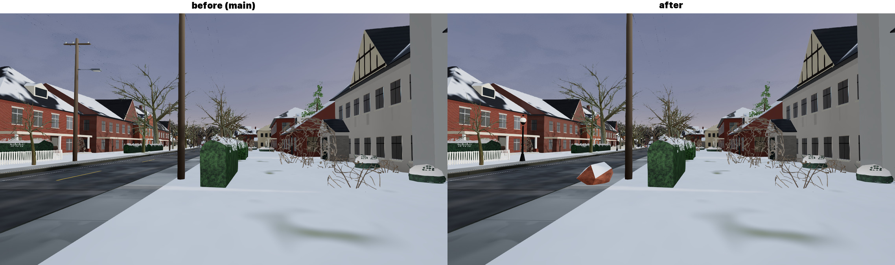
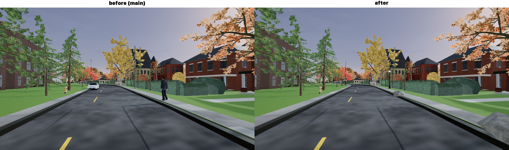
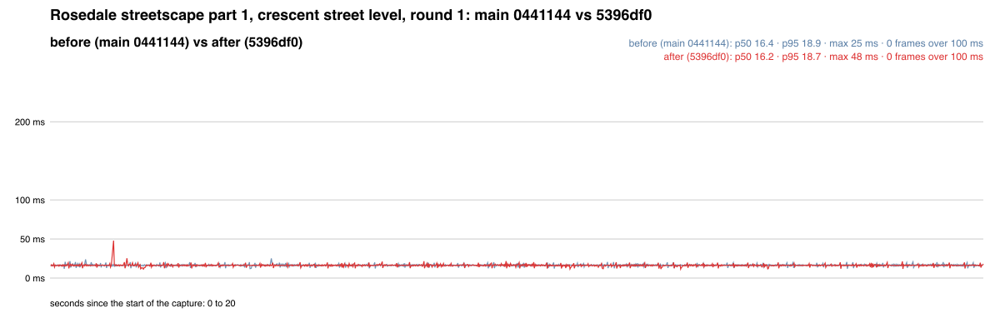

# Rosedale streetscape: from John's own photos

Bead `jf-qw7`, 2026-11-27. John's three own photographs of Rosedale (Chestnut Park on 22 October and 22 November 2020, and a Rosedale street on 2 October 2020) show what the game gets wrong there.
The photographs are private: they are not in this repository, and nothing here copies them. What they show, in words:

- **Chestnut Park, 22 October:** a narrow winding road with no painted lines, a low concrete curb, black cast-iron lamp posts about 4 m tall with a white globe on top, one on each side every 25 to 30 m; wide grass
  boulevards with a paved walk behind them; huge mature street trees (ash, maple, honey locust) arching over the whole road; clipped hedges (low boxwood along the walks and beds, tall dense hedges on the lot lines); a red
  Japanese maple in a front yard; a brick-paved drive; brown paper leaf bags standing at the curb; fallen leaves on the road and the lawns; a parked car at the end of a drive.
- **Chestnut Park, 22 November:** the same bend in snow: snow on hedges and branches, the posts and globes with snow caps, boulders (large rough reddish sandstone ones in a row, and grey granite ones) along the curb and at lawn corners and drive
  mouths, cars parked in the drives.
- **A Rosedale street, 2 October:** the road's edge is a plain concrete curb, the boulevard a wide strip of lawn with a few large grey boulders, big trees right at the curb, an ivy-covered brick house, tall clipped hedges against the
  walls and along the lot lines, small black lamp posts with globes in the distance, overhead wires.

## PR 1: quick wins (centre lines, lamp posts, boulders)

### 1. No centre line on local streets

The page painted a yellow dashed centre line on every two-way street. `js/road-paint.js` now leaves it off a **local street**: one whose OSM class is residential, unclassified or a living street (road-network `rank` 1 or less) and whose carriageway is
under 10 m (half under 5 m). `js/road-network.js` carries `rank` into `paintEdges` (the downtown grid's own streets have none and keep their line).

Real practice: Toronto paints centre lines on its collector and arterial roads and not on local residential streets, which is why Chestnut Park's road is bare in the photographs. The City's Centreline (`FEATURE_CODE_DESC`: Local, Collector, Minor Arterial, Major Arterial)
is the source of truth for that class, but the page's road graph is OpenStreetMap's. Joining the two over 12,000 sampled points on residential roads (shared data cache, `centreline.csv`): **87% Local, 9% Collector, 4% other**; OSM tertiary roads are Collector 45%
and Minor Arterial 48%. So the OSM class is a good proxy: residential and unclassified roads lose the line, tertiary and above keep it. Crescent Rd is OSM tertiary and a City Collector, so it keeps its line; Chestnut Park, Roxborough Dr, Elm Ave's residential
stretches, Glen Rd and Rosedale Rd lose theirs. Citywide it is 6,105 residential and 228 unclassified road pieces of the Eglinton frame.

Limit: about one residential piece in ten is a City Collector, which now has no line; a per-street City class in the geodata would settle it (a data rebuild, not done here).

### 2. Rosedale's lamp posts

The City maps the lamps as ordinary "street light poles" and "pedestrian light poles" with no height or look, so nothing in its data tells Rosedale's posts from a cobra-head on a hydro pole. The rule is therefore by place: `tools/build-rosedale-zone.mjs`
makes `js/rosedale-zone.js`, a 20 m mask (4,345 cells, 2 KB) of everything within 34 m of a house in the South or North Rosedale Heritage Conservation District (1,518 houses from the shared data repo's `rosedale-houses/1`, joined to the pilot's `rosedale-houses.bin`), closed
over the street gaps. 133 of Moore Park's and Summerhill's 1,953 untagged houses lie inside the mask at its edge. A mapped street light or pedestrian light in the mask, on a street that is no more than a collector (OSM rank 2 or less), is drawn as the new look
`globe` (`js/mapped-poles.js`): a 4 m black cast-iron post (fluted base, tapering shaft, a ring, a cup) with a white opal globe that glows at night and casts a lamp pool (`street-details.js`). Where the City mapped no light in the zone the procedural fill (a tall grey pole) is now
skipped. The 9 m light and signal poles at junctions keep their shape. `?rosedaleStreet=0` keeps the old poles.

### 3. Boulders

`js/front-yards.js`: grey granite and reddish sandstone boulders in the boulevard, found by marching out from the lot line to the road's pavement edge (`edgeAt`, from `nearestRoads`' width), 0.4 m behind the curb: at the mouth of a drive (half the time each side), at the lot's
corner (30%), now and then one in the middle of the frontage, and on one lot in ten a row of three to five. Each is a 20-triangle flat-shaded icosahedron pushed about, sunk a third into the ground, drawn with the yard material (kind 12: speckle and streaks, a snow cap in
winter). A stable seed per house, so a rock is where it was on every load. Rosedale styles only.

## Pictures

Same camera before (origin/main `0441144`) and after, on the Mac mini, 1600 x 900, no season preset: 22 October 2026 (autumn colour) and 22 November 2026 with 6 cm of snow, the dates of John's two Chestnut Park photographs. Side-by-side sheets with his photos
are in his private review folder (`slop-toronto-updates/2026-11-27-rosedale-streetscape/`); the pictures here are the game's frames only.








## Cost

Mac mini (Apple M4) through `gpu2`, shared with a production transcription job (relative, not budgets), 1600 x 900, uncapped, 20 s recordings, today's date (bare trees), origin/main `0441144` against `5396df0`, alternated
(round 2 ran "after" first). Mean / median frame interval, ms, before -> after, at street level (budget +0.5 ms):

| Place | Round 1 | Round 2 (after first) |
|---|---|---|
| Chestnut Park | 19.04 -> 19.07 (+0.04) / 19.00 -> 19.10 | 19.07 -> 19.10 (+0.03) / 19.00 -> 19.10 |
| Crescent Rd | 16.45 -> 16.22 (-0.23) / 16.40 -> 16.20 | 16.27 -> 16.23 (-0.03) / 16.20 -> 16.20 |




## What is still wrong

- A City Collector that OpenStreetMap calls residential (about 1 in 10 residential road pieces) loses its centre line; a per-street City class in the geodata would settle it.
- The lamp zone is the two Heritage Conservation Districts: North Rosedale's lamps were assumed to match South Rosedale's (the photographs are of Chestnut Park, South Rosedale). The City maps no height or look, so there is no data to check against.
- Boulders are a rule (a stable seed per lot), not a survey; their number follows what the photographs show, not a count.

## Reproduce

```sh
node tools/build-rosedale-zone.mjs ~/.cache/toronto-data/derived/rosedale-houses/1/houses.csv   # js/rosedale-zone.js
node --test tests/rosedale-streetscape.test.mjs tests/road-paint-cells.test.mjs tests/front-yards.test.mjs tests/mapped-poles.test.mjs
SHOTS=tools/shots/rosedale-streetscape.json ARMS="beforeFall afterFall beforeSnow afterSnow" bash tools/capture-rosedale-streetscape.sh   # on the Mac mini through gpu2
```
