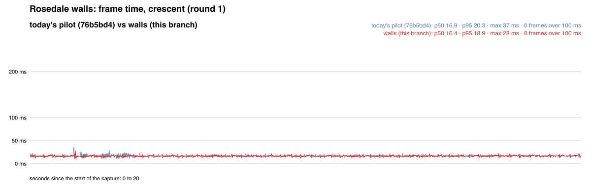
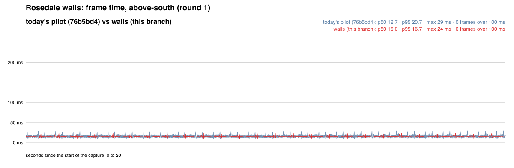
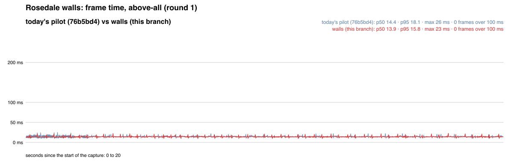
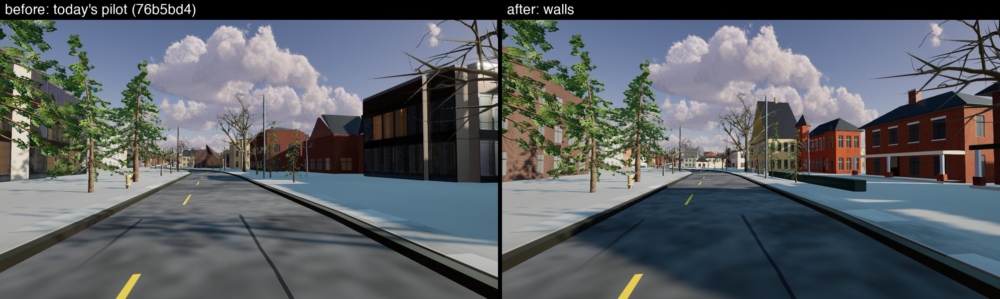
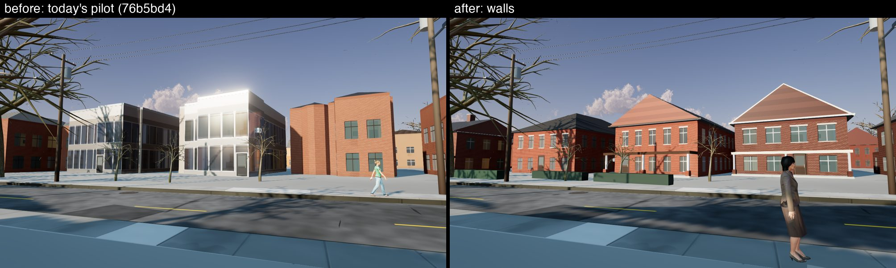
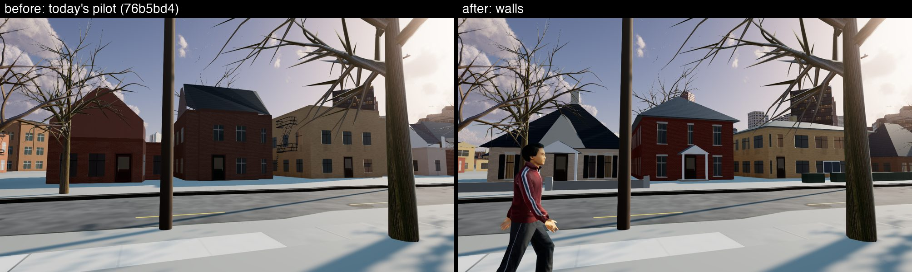

# Rosedale-Moore Park walls: the pilot's houses drawn as houses

Bead `jf-bya`, 2026-11-27. Part 2 of [the Rosedale pilot](rosedale-pilot.md) (epic `jf-5i1`, [the spike](rosedale-spike.md)). After the pilot many houses still read
as small office buildings from the street: glass curtain walls, shop-front ground floors, flat grids of windows, white boxes, roofs that only showed from the air. This
makes the houses read as detached 2.5 to 3 storey brick, stucco and half-timbered houses with pitched roofs, porches, bays and chimneys behind a front yard. On by default,
with the pilot (the bigger map, desktop); `?rosedalePilot=0` keeps the boxes, `?presets=0` keeps the pilot as it was.

## 1. No curtain walls, no shop fronts

The City's `kind` column calls 1,457 of the pilot's 3,471 parts mid-rise and 86 tall. They are houses (a lidar roof under 16 m, a footprint under 450 m2). The page drew a third
of the mid-rise ones and every "tall" one as curtain-wall glass, and gave a part on a shopping street a shop-front ground floor. `js/rosedale-houses.js` `isHouse` now says which
pilot parts are houses (3,166 of the 3,411 merged); `js/buildings.js` draws such a part as a low-rise house whatever the column says (`kind` 0: no glass, no fire escape, no sign,
no shop front). No other pilot building (the 245 apartments and institutions) is drawn in curtain wall either, a building in the Rosedale pilot takes brick or render. Anywhere in the
downtown frame a house preset (`isHousePreset`: any detached, semi or row) never takes the glass or a shop front either: a house the preset rule cannot fit used to keep the glass.

## 2. Houses drawn from the preset machinery

The house presets of [building-presets.md](building-presets.md) (`js/building-draw.js` `planHouse`: porches, bays, dormers, bargeboards, half-timber, sills, lintels) now draw
the pilot's houses; there is no second system. 2,449 of the 3,166 plan (the rest keep the pilot's own outline walls and lidar roof, in brick: a house needs a clean street edge, a
front 3 m or more wide and an outline that fills 86% of its composed block; the downtown presets ask 80%).

**Style to preset.** Each house's derived style code ([the pilot](rosedale-pilot.md#what-it-does)) picks a preset by a hash of its City id (the same on every load); a semi or a row
takes the era's semi preset. The catalogue's presets are used where it has them; the Rosedale presets it lacked are `ROSEDALE_DRAW` in `js/building-prototypes.js` (not
catalogue entries: the presets file's ids are the catalogue's), in the order of how many houses each covers:

| Style code (houses) | Presets | What it adds |
|---|---|---|
| Edwardian and plain (1,552 + 0) | `edwardian-detached` 711, `rosedale-annex` 420, `rosedale-arts-crafts` 325 (and `edwardian-semi` 100) | the Annex: dark brick, a two-storey bay beside the porch, a hip or front gable; Arts and Crafts: a broad low roof with 0.9 to 1.25 m eaves, a big front gable, a porch on heavy piers; the Edwardian presets' windows become a metre-wide sash (`edwardian-sash`) where the downtown ones are an office's 1.8 m |
| Post-war (534) | `postwar-detached` 370, `postwar-semi` 43 | as the catalogue |
| Georgian and Colonial revival (488) | `rosedale-georgian` 556 | a symmetrical block, the door in the middle under a gabled portico on two columns, shuttered sash windows, a hip or side gable, slate |
| Revival infill (329) | Georgian, Tudor, 26 `recent-detached` | |
| Tudor, English cottage (310) | `rosedale-tudor` 324 | a steep cross gable, half-timbered gables, a tall front chimney, a gabled entrance, casements |
| Victorian and Queen Anne (258) | `rosedale-queen-anne` 158, `victorian-detached` 78, `victorian-semi` | a corner turret under a cone, a steep front gable, bargeboards, a porch, patterned slate |

(Preset totals are the 3,166 houses, counted before the plan: a house that cannot be fitted keeps the pilot's walls.) Two facade styles were added to the rendered material for
the Georgian and Tudor windows and one for the Edwardian sash: the material holds 16 styles and now uses all of them. Walls and brick come from each preset's palette (red, red-brown
and clinker brick, stucco, stone); the roof colour is the pilot's per-style slate, cedar or asphalt (`LOOKS`).

## 3. Roofs that read from the street

- **The lidar chooses the roof.** `roofHint` reads each lidar house's roof facets: two opposite slopes are a gable, four a hip, in between a gable with a cross gable, near flat a flat
  roof; the mean slope is the pitch. The ridge's direction against the street edge makes a gable face the street (front gable) or run along it (side gable). 98% of the planned
  houses follow it (`tests/rosedale-walls.test.mjs`). The wall height gives the storeys (2 or 3). Houses the fit left to the roof planner (847) take their preset's own forms.
- **Eaves** are the preset's (0.35 to 0.8 m; Arts and Crafts 0.9 to 1.25 m), over the wall.
- **Chimneys from lidar spikes.** `build/rosedale-houses/chimneys.py` in the shared data repo finds returns standing more than 0.8 m over the fitted roof planes (a compact piece 0.3 to
  1.8 m across): 1,802 stacks on 1,164 of 3,822 fitted parts (record `rosedale-chimneys-lidar`). `tools/build-rosedale-houses.mjs` puts them in the houses file (1,211 on 854 houses
  that are drawn as houses); the page draws each where it stands, to the height it reaches (at most 3 m over its roof). A house with none found takes its preset's chimney
  (Georgian: at the gable ends; Tudor: a tall stack on the front wall; the rest on the ridge) at 60% of the preset's chance, so a roof the fit missed is not bare. The lidar finds only
  stacks that stand 0.8 m up and show 8 returns: the count is a floor.

## 4. Front yards

`planHouse` draws, in the near roof batch, per house: a walk from the door to the lot line, a hedge (dark cedar green, 0.9 to 1.6 m) or a low stone or brick wall with piers along the lot line (about two
houses in five; a gap at the walk), and a drive. The lot line is where the road's centreline is 8.2 m away (half the road, the boulevard and the sidewalk), so the yard is the setback
the page's own roads leave; under 2.2 m deep no hedge or wall is drawn. The lot's width is the City parcel's short side (`rosedale-houses/1` `lots.json`, 12 m median) carried in the
file (`lotW`, in decimetres) and bounds the side yards; a side drive (3 m, 3 houses in 10) only where there is room; the 347 houses with a City-licensed front-yard parking permit
(`park`) get a drive pad in the front yard. No lawn is drawn: the ground there is already the season's (the page's grass, or snow in winter), and a flat green sheet on snow was the first thing wrong.

## 5. Cost

Same camera, Mac mini (Apple M4) through `gpu2`, 2026-11-27, 1600 x 900, uncapped, 20 s recordings (`tools/frame-time-chart.mjs --overlay`), **today's pilot** (origin/main `76b5bd4`) against
this branch, alternating (pilot, walls, pilot, walls) in four jobs on a mini shared with other agents, so relative figures, not budgets. Median frame interval, ms (round 1 / round 2):

| Place | Today's pilot | Walls | Difference |
|---|---|---|---|
| Crescent Rd, street level | 16.9 / 16.7 (p95 20.3 / 20.8) | 16.4 / 16.6 (p95 18.9 / 19.2) | -0.5 / -0.1 |
| South Rosedale, 160 m up | 12.7 / 12.8 (p95 20.7 / 20.7) | 15.0 / 15.2 (p95 16.7 / 17.1) | +2.3 / +2.4 |
| Whole neighbourhood, 520 m up | 14.4 / 14.3 (p95 18.1 / 17.5) | 13.9 / 13.9 (p95 15.8 / 15.6) | -0.5 / -0.4 |

The budget was no worse than +1 ms at street level: met (the street is a little faster, the 95th percentile clearly so). From 160 m up the pilot was already the dearest view and the walls add 2.3 ms:
the near roof batch now holds a roof, porch, chimney and yard shapes for 2,449 houses where the pilot's lidar roofs held about 50 triangles a house (roof triangles in the page: 1.70 M to 2.00 M, near and far;
near-tier wall triangles 1.44 M to 1.48 M; 8.4 k more bay, porch and pier records). The view over the whole neighbourhood is dominated by the far tier and is not slower. Start-up cost is
not measurable in the `[init]` lines (`blocks` 3,223 and 3,194 ms; a node run plans and writes all 2,449 houses in about 0.12 s). Data: the houses file is 0.49 MB gzip (0.48 before: lots and chimneys).
Houses the page draws with curtain-wall glass: 15,624 to 13,364; shop fronts: 7,691 to 7,577.







## 6. Pictures

The 16 views of [the pilot's pictures](rosedale-pilot.md#pictures) (six houses each from 30 m along the street and from across it, four streets), re-shot with the same cameras, plus three night views
at 21:30, before (today's pilot) and after, in John's review folder `slop-toronto-updates/2026-11-27-rosedale/walls/` (a side-by-side per view, and the raw frames in `before/` and `after/`). Three of them:







Not every view is a clear win: the Highland Avenue camera stands in a notch of a house's outline and the composed block now fills a little of it; the Douglas Drive and Beaumont Road views are mostly
the page's grass and a tree; the night frames show lit windows and roofs against the snow but the houses are dark masses.

## What is still wrong

- The preset rule composes a clean rectangle at the front and the real outline behind: a house with an L or a step in front is drawn as its own outline (14% of the preset houses) or its rectangle
  covers a little of the notch.
- Windows are the facade shader's grid in the preset's rhythm: no per-house window pattern, no leaded glass, no real doors; porches are the downtown presets' (brick piers or two columns), not Rosedale's
  stone-and-timber porches. Stone, stucco and half-timber are colours and gable beams; no ashlar courses.
- Hedges and walls are drawn from a rule (about two houses in five); no open layer maps them. The drive is a flat grey sheet.
- Lidar stacks are a floor (see 3); the lot frontage is the parcel's short side, which is wrong on corner lots.
- The 245 pilot buildings that are not houses (apartments, institutions, 1 to 3 storeys over 450 m2) keep their box walls in brick or render with the lidar roof where there is one.

## Reproduce

```sh
# chimneys (shared data repo; its venv, see build/rosedale-houses/README.md), then the houses file with lots and chimneys
~/.cache/slop-toronto/rosedale-spike/venv/bin/python ~/code/toronto-data/build/rosedale-houses/chimneys.py "$TORONTO_DATA_CACHE/derived/rosedale-roofs/1/chimneys.json"
node tools/build-rosedale-houses.mjs "$TORONTO_DATA_CACHE/derived/rosedale-roofs/1/roofs.json" "$TORONTO_DATA_CACHE/derived/rosedale-houses/1/houses.csv"
node --test tests/rosedale-walls.test.mjs tests/rosedale-houses.test.mjs
JOB="houses night" ARMS="after" bash tools/capture-rosedale.sh   # on the Mac mini through gpu2, see the script's header
```
